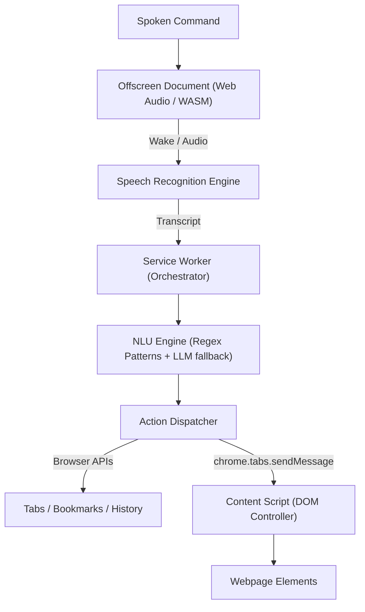

# VORDI

> **Voice-Operated Remote-Directed Interface**  
> A next-generation smart browser extension enabling complete hands-free navigation and internal element control via natural voice commands.

---

## Overview

VORDI transforms how users interact with the web by replacing mouse clicking and keyboard typing with intelligent voice recognition and intent-driven DOM automation. Built for speed, accessibility, and precision, VORDI operates under Chrome Manifest V3 using an isolated **Offscreen Document** architecture.

### Key Capabilities
- 🗣️ **Local Wake-Word Detection:** Always-on trigger (*"Hey VORDI"*) with zero idle cloud egress.
- 🧭 **Browser Control:** Open/close tabs, switch tabs, pin, duplicate, navigate history, zoom, and manage bookmarks.
- 🎯 **Deep DOM Manipulation:** Target buttons, links, inputs, and controls via natural labels or visual numbered badges (Element Picker).
- 📝 **Framework-Aware Form Filling:** Automatically updates native setters to support React, Vue, and Angular reactive states.
- 🔁 **Voice Macros:** Record and replay complex workflows with smart page-load awaiting.
- 🛡️ **Safety & Undo Stack:** Roll back accidental navigations or tab closures with *"Undo that"*.

---

## 🏗️ Architecture

---

## 📚 Specifications & Documentation

Complete software engineering documentation is available in the [`docs/`](./docs) directory:

- 📋 [**Software Requirements Specification (SRS v1.1)**](./docs/VORDI_SRS_v1.1.md)
- 📐 [**System Design Document (SDD v1.1)**](./docs/VORDI_SDD_v1.1.md)
- 🔍 [**Design Audit & Architectural Review**](./docs/VORDI_Design_Audit.md)
- 🐍 [**Python Backend Replacement Analysis**](./docs/VORDI_Python_Replacement_Analysis.md)
- 📦 [**Software & Tools Requirements**](./docs/VORDI_Software_Requirements.md)

---

## 🛠️ Tech Stack

- **Extension Framework:** Chrome Extension Manifest V3 (TypeScript, Webpack 5)
- **Audio Processing:** Web Audio API, AudioWorklet, Web Speech API (Offscreen Document)
- **UI & Overlays:** Preact, Shadow DOM
- **Intent Parsing:** Custom `PatternCompiler` (Regex) + Google Gemini Flash API fallback
- **DOM Engine:** Native DOM traversal with fuzzy text scoring and reactive form setters
- **Companion Backend (Optional):** Python (FastAPI, WebSockets, `faster-whisper`, `spaCy`)

- **DEVELOPED BY:**
- Harsh Gupta
- Divya Maliwal
- 

---
