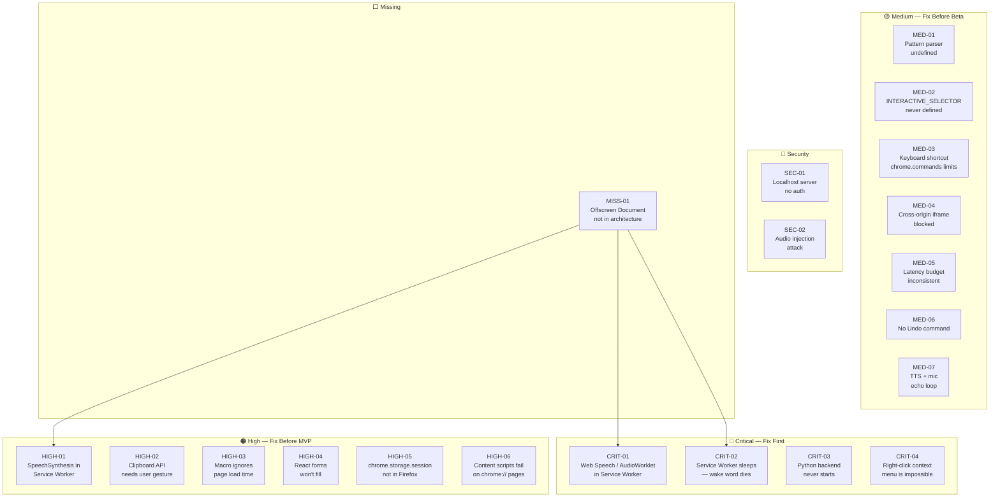

# VORDI — Design Audit Report
## Flaws, Broken Endpoints & Architectural Issues

| Field | Value |
|---|---|
| **Audit Date** | November 7, 2026 |
| **Documents Reviewed** | SRS v1.0, SDD v1.0, Python Replacement Analysis v1.0 |
| **Total Issues Found** | 24 |
| **Critical** | 4 |
| **High** | 6 |
| **Medium** | 7 |
| **Low** | 4 |
| **Security Gaps** | 2 |
| **Missing Components** | 1 |

---

## Severity Key

| Label | Meaning |
|---|---|
| 🔴 **CRITICAL** | Will break the product entirely at runtime — must fix before any code is written |
| 🟠 **HIGH** | Breaks a core feature under real-world conditions |
| 🟡 **MEDIUM** | Causes degraded UX or unexpected failures in edge cases |
| 🔵 **LOW** | Minor inconsistencies, misleading docs, or future-proofing gaps |
| 🔐 **SECURITY** | Active security vulnerability in the design |
| ⬜ **MISSING** | Entire component or requirement not addressed in any document |

---

## 🔴 CRITICAL Issues (4)

---

### CRIT-01 — Web Speech API & AudioWorklet Cannot Run in a Service Worker

**Found in:** SDD §3.1, §3.2 | **Affects:** SRS FR-VA-01, FR-VA-02, FR-VA-03

**The Flaw:**
The SDD places both the **Wake Word Engine** (using `AudioWorkletProcessor`) and the **ASR Module** (using `SpeechRecognition` / Web Speech API) inside the **Background Service Worker**. This is architecturally impossible.

- `SpeechRecognition` (Web Speech API) requires a **browsing context** (a window/tab). It cannot be instantiated in a Service Worker — it throws `ReferenceError: SpeechRecognition is not defined`.
- `AudioWorklet` and `getUserMedia()` are also **not available** in Service Workers — they require a `Window` or `AudioContext` tied to a browsing context.
- MV3 Service Workers have **no DOM, no Web Audio API, no MediaStream**.

**Impact:** The entire voice capture pipeline is broken on paper. If coded as designed, the extension would crash immediately on load.

**Fix:**
Use a **Chrome Offscreen Document** (introduced in Chrome 109, MV3 supported) — a hidden background page with a full DOM context that can run `AudioWorklet`, `getUserMedia`, and `SpeechRecognition`. The Service Worker stays as the orchestrator; the Offscreen Document does all audio processing.

```
Service Worker (orchestrator)
    ↕ chrome.runtime.sendMessage
Offscreen Document (audio-processor.html)
    ├── Wake Word Engine (AudioWorklet)
    ├── ASR Module (SpeechRecognition / MediaStream)
    └── TTS Module (SpeechSynthesis)
```

Add to `manifest.json`:
```json
"permissions": ["offscreen"]
```

The file structure needs a new entry:
```
src/offscreen/
  ├── offscreen.html
  └── offscreen.ts   ← Wake Word + ASR + TTS live here
```

---

### CRIT-02 — MV3 Service Worker Goes to Sleep — "Always-On" Wake Word is Impossible

**Found in:** SDD §3.1, SRS FR-VA-03 | **Affects:** entire listening pipeline

**The Flaw:**
SRS FR-VA-03 requires *"continuous listening mode (always-on)"* and the Wake Word is described as *"always-on without sending audio to any service"*.

MV3 Service Workers are **event-driven and not persistent**. Chrome will terminate (suspend) the Service Worker after **~30 seconds of inactivity** (or up to 5 minutes for some events). Once suspended, no audio listening can occur — the wake word engine dies silently.

**Impact:** The core "Hey VORDI" wake word feature will randomly stop working after 30 seconds of browser idle time. Users will have no idea VORDI has gone deaf.

**Fix (two-pronged):**

1. **Move the wake word engine to the Offscreen Document** (see CRIT-01 fix). Offscreen Documents persist as long as they are referenced and are not subject to the same sleep rules.
2. **Keep the Service Worker alive via a heartbeat** using `chrome.alarms` (which is MV3-safe):
```typescript
// In service worker
chrome.alarms.create("keepAlive", { periodInMinutes: 0.4 }); // every 24s
chrome.alarms.onAlarm.addListener((alarm) => {
  if (alarm.name === "keepAlive") {
    // ping offscreen document to confirm audio pipeline is alive
    chrome.runtime.sendMessage({ type: "PING" });
  }
});
```
3. Add a **recovery mechanism** that re-creates the Offscreen Document if it becomes unresponsive.

---

### CRIT-03 — Python Backend Has No Auto-Start Mechanism

**Found in:** Python Replacement Analysis — Hybrid Architecture | **Affects:** entire Python-hybrid design

**The Flaw:**
The Python analysis proposes a FastAPI backend running on `localhost` handling ASR, NLU, TTS, and Wake Word. However **no document describes how the Python server starts**. 

A browser extension cannot:
- Launch a native process (Python interpreter) directly
- Guarantee the user has Python installed
- Guarantee the user knows to run `uvicorn main:app` before using VORDI

**Impact:** In the hybrid architecture, the extension would silently fail to connect to `ws://localhost:8000` on every launch. The entire intelligence layer would be dead with no user-facing explanation.

**Fix (two options):**

**Option A — Native Messaging Host** (recommended):
Use Chrome's `nativeMessaging` permission to launch the Python process from the extension:
```json
// manifest.json
"permissions": ["nativeMessaging"]
```
Register a Native Messaging Host manifest at the OS level that points to a Python launcher script. The extension calls `chrome.runtime.connectNative("com.vordi.backend")` and Chrome starts the Python process automatically.

**Option B — Companion Installer**:
Ship a standalone installer (`.exe` / `.pkg` / `.deb`) that:
- Installs Python + dependencies into a bundled environment
- Registers the Native Messaging Host manifest
- Creates an OS startup service (Windows: Task Scheduler / macOS: LaunchAgent / Linux: systemd)

---

### CRIT-04 — `FR-DOM-09`: Right-Click Context Menu is Technically Impossible

**Found in:** SRS FR-DOM-09 | **Priority listed:** P3

**The Flaw:**
The requirement states: *"The system SHALL right-click to show context menus on 'Right-click [element]'"*.

Browsers **do not allow any script** (extension or otherwise) to programmatically open the **native OS context menu**. `element.dispatchEvent(new MouseEvent('contextmenu'))` fires the JS event but does **not** open the browser's right-click native menu. This is a security boundary that cannot be crossed.

**Impact:** This requirement is literally impossible to fulfill as stated.

**Fix:**
- **Remove** FR-DOM-09 from the SRS, OR
- **Replace** with: *"The system SHALL show a VORDI-custom context action panel for the targeted element (Copy link, Open in new tab, Inspect, etc.)"* — achievable via a custom UI overlay.

---

## 🟠 HIGH Issues (6)

---

### HIGH-01 — `SpeechSynthesis` API Also Broken in Service Worker

**Found in:** SDD §3.7 (TTS Module placed in Background Service Worker)

**The Flaw:**
Same root cause as CRIT-01. `window.speechSynthesis` does **not exist** in a Service Worker context. All TTS calls from the Service Worker will throw `ReferenceError`.

**Fix:** Move the TTS Module to the **Offscreen Document** alongside ASR (see CRIT-01 fix). The Service Worker sends TTS text requests via `chrome.runtime.sendMessage`; the Offscreen Document calls `speechSynthesis.speak()`.

---

### HIGH-02 — Clipboard API Requires User Focus and Secure Context

**Found in:** SRS FR-DOM-06 (Copy), FR-DOM-07 (Paste) | SDD §3.6

**The Flaw:**
`navigator.clipboard.readText()` (Paste) requires:
1. The document must have **user focus** (the tab must be active and recently clicked)
2. The user must grant explicit **"clipboardRead"** permission (a separate browser prompt)
3. Only works in **HTTPS contexts** (or localhost)

A content script triggering clipboard read *after* a voice command (without a direct user gesture) will be **denied** by the browser in most cases.

**Impact:** "Paste" command will silently fail on most websites. "Copy" (`clipboard.writeText`) is slightly more lenient but still requires focus.

**Fix:**
- Use `document.execCommand('copy')` and `document.execCommand('paste')` as fallback (deprecated but still works without gesture requirement in content scripts)
- For Paste: store clipboard content in `chrome.storage.session` and inject it directly as a string — avoid `clipboard.readText()` entirely
- Clearly document these limitations in the SRS constraint table

---

### HIGH-03 — Macro Engine Doesn't Account for Page Load Time Between Steps

**Found in:** SDD §3.8 (Macro Engine)

**The Flaw:**
The Macro Engine executes steps sequentially with a fixed `delayBefore` (default 800ms). If Step 1 navigates to a new page, the next step fires 800ms later — but the new page may take 2–5 seconds to fully load and inject a content script.

**Scenario that breaks:**
```
Step 1: Navigate to gmail.com        (page load: ~3 seconds)
Step 2: Click "Compose" button       (fires at 800ms — page not ready → ELEMENT_NOT_FOUND)
```

**Impact:** Any macro involving navigation will be unreliable.

**Fix:**
Add a **page-ready handshake** between the Macro Engine and Content Script:
```typescript
// After navigation action, Macro Engine listens for:
chrome.tabs.onUpdated.addListener((tabId, changeInfo) => {
  if (changeInfo.status === "complete") {
    // Now safe to execute next DOM step
    proceedToNextMacroStep();
  }
});
```
Replace fixed `delayBefore` with a **smart wait**: either `tabs.onUpdated` for navigation steps, or a DOM `MutationObserver` for SPA transitions.

---

### HIGH-04 — React / Vue / Angular Form Filling Will Not Work

**Found in:** SDD §8.2 (Form Filling Strategy)

**The Flaw:**
The design sets `element.value = text` and dispatches `input` + `change` events. This works for vanilla HTML forms, but **React, Vue, and Angular hijack input elements** using their own synthetic event systems:

- **React** uses a custom `InputEvent` and reads from an internal `fiber` object — setting `.value` directly bypasses React's state and the field visually fills but React's state is not updated → form submit sends **empty data**.
- **Vue** uses `v-model` which listens to `input` events, but only if triggered through the native input event **path** React wraps.

**Impact:** Form filling fails silently on ~70% of modern web applications (Gmail, Twitter, GitHub — all use React/Vue).

**Fix:**
Use the **native input value setter** trick (React-specific workaround):
```typescript
const nativeInputValueSetter = Object.getOwnPropertyDescriptor(
  window.HTMLInputElement.prototype, 'value'
)?.set;
nativeInputValueSetter?.call(element, value);
element.dispatchEvent(new Event('input', { bubbles: true }));
element.dispatchEvent(new Event('change', { bubbles: true }));
```
This bypasses React's override and triggers proper state update. Add framework-detection logic to apply the right fill strategy per page.

---

### HIGH-05 — `chrome.storage.session` Not Supported in Firefox

**Found in:** SDD §3.9 (Storage Architecture)

**The Flaw:**
`chrome.storage.session` was added in Chrome 102 (April 2022). **Firefox does not support it** as of Firefox 115 (the stated minimum). The SRS targets Firefox compatibility.

Storing `Active Listening State`, `Current Recording Macro`, and `Element Picker State` in `chrome.storage.session` will cause the extension to silently fail on Firefox — no error thrown, just `undefined` reads.

**Fix:**
- Use an **in-memory Map** in the Service Worker for truly ephemeral session state
- Add a polyfill check: `if (chrome.storage.session) { ... } else { useInMemoryFallback() }`
- Or restrict `chrome.storage.session` to Chrome-only code path with `webextension-polyfill` shim for Firefox

---

### HIGH-06 — Content Scripts Fail on `chrome://`, PDF, and Extension Pages

**Found in:** SDD §3.6 | **Affects:** SRS FR-DOM-01 through FR-DOM-10

**The Flaw:**
The `manifest.json` lists `"matches": ["<all_urls>"]` for content script injection. However, browsers **block content script injection** on:
- `chrome://` pages (Settings, Extensions, Downloads, New Tab by default)
- `chrome-extension://` pages
- `about:blank`, `about:newtab`
- Native PDF viewer pages (`chrome-extension://...pdf`)
- Pages with **CSP `script-src`** that blocks injected scripts

**Impact:** Any DOM command on these pages will cause the content script to silently not exist — the dispatcher sends a message to a tab with no content script, the message is undelivered, no response arrives, and the system hangs waiting for a reply.

**Fix:**
1. Add a **tab type check** before sending DOM messages:
```typescript
const tab = await chrome.tabs.get(tabId);
if (tab.url?.startsWith("chrome://") || tab.url?.startsWith("chrome-extension://")) {
  return { success: false, error: { code: "UNSUPPORTED_PAGE", detail: "Voice commands cannot control browser system pages." } };
}
```
2. Set a **timeout** on all `chrome.tabs.sendMessage` calls (currently missing from the design)
3. Handle `chrome.runtime.lastError` on every message send

---

## 🟡 MEDIUM Issues (7)

---

### MED-01 — Intent Pattern Parser is Undefined

**Found in:** SDD §3.3 (Intent Registry JSON)

**The Flaw:**
The intent registry uses patterns like `"go to {url}"`, `"switch to tab {index}"` with `{placeholder}` syntax — but **no parser for this mini-grammar is designed** anywhere in the SDD. How does the Rule Engine extract `{url}` from the pattern and match it against arbitrary input? The extraction logic is assumed but never specified.

**Fix:** Define the pattern-matching algorithm explicitly:
1. Convert pattern to regex: `"go to {url}"` → `/^go to (.+)$/i`
2. Named capture groups: `/^go to (?<url>.+)$/i`
3. Run entity-type-specific post-processing on each captured group
Document this in a new SDD §3.3.1 "Pattern Compilation Engine".

---

### MED-02 — `INTERACTIVE_SELECTOR` is Referenced but Never Defined

**Found in:** SDD §8.1 (Element Finding Algorithm)

**The Flaw:**
```typescript
const all = document.querySelectorAll(INTERACTIVE_SELECTOR);
```
`INTERACTIVE_SELECTOR` is used in the core algorithm but **never defined** in any document. This is a critical undefined constant.

**Fix — Define it explicitly:**
```typescript
const INTERACTIVE_SELECTOR = [
  'a[href]',
  'button:not([disabled])',
  'input:not([type="hidden"]):not([disabled])',
  'select:not([disabled])',
  'textarea:not([disabled])',
  '[role="button"]',
  '[role="link"]',
  '[role="menuitem"]',
  '[role="tab"]',
  '[role="checkbox"]',
  '[role="radio"]',
  '[tabindex]:not([tabindex="-1"])',
  'summary',
  'label[for]',
].join(', ');
```

---

### MED-03 — Push-to-Talk Keyboard Shortcut Conflicts with `chrome.commands` Limits

**Found in:** SRS FR-VA-02 | SDD §3.9 (`pushToTalkShortcut: string`)

**The Flaw:**
The SRS says the push-to-talk shortcut is "configurable" and the settings schema allows arbitrary string values. However `chrome.commands` API has strict limitations:
- Max **4 keyboard shortcuts** per extension
- Only specific key modifiers allowed: `Ctrl`, `Alt`, `Shift`, `MacCtrl` — **not arbitrary key combos**
- Shortcuts must be declared in `manifest.json` — they **cannot be changed programmatically at runtime** (only via `chrome.commands.update()` in Chrome 109+, not Firefox)

**Fix:**
- Limit push-to-talk to a **predefined set** of allowed shortcuts declared in `manifest.json`
- Use `chrome.commands.update()` for Chrome 109+ to allow changing within allowed bounds
- Remove the free-form `pushToTalkShortcut: string` setting — replace with an enum of valid options

---

### MED-04 — Element Picker Fails Inside Cross-Origin Iframes

**Found in:** SDD §3.6 (DOM Controller)

**The Flaw:**
If the target element is inside a **cross-origin iframe** (e.g., an embedded YouTube video, Stripe payment form, Google Maps embed), the content script has **zero access** to the iframe's DOM due to the same-origin policy. The Element Finder will never find elements inside these iframes.

**Impact:** Cannot click "Pay Now" in an embedded Stripe iframe. Cannot interact with embedded third-party widgets.

**Fix:**
1. **Detect iframes** during element scan and mark them as `[cross-origin iframe — not accessible]`
2. Tell the user via TTS: *"This element is inside an embedded frame and cannot be controlled by voice"*
3. As a workaround: inject content script into **same-origin iframes** only (permitted by `all_frames: true` in manifest)

Add to `manifest.json`:
```json
"content_scripts": [{ "all_frames": true, "matches": ["<all_urls>"] }]
```

---

### MED-05 — Latency Budget is Internally Inconsistent

**Found in:** SDD §13.1 (Latency Budget)

**The Flaw:**
The latency budget states:
> `[ASR transcription]: ≤ 800ms (Web Speech API, real-time)`

But Web Speech API's **final** result (marked `isFinal: true`) can take **2–8 seconds** for longer commands. The 800ms figure only applies to the first partial result, not the final transcript. The pipeline cannot act on partial results for most commands (you don't know the full intent until the utterance is complete).

Additionally, the SDD says NFR-PERF-01 (in SRS) requires ASR ≤ 1.5s — but the latency budget allocates 800ms to ASR alone, leaving only 700ms for NLU + Dispatch + DOM action. These numbers don't add up consistently.

**Fix:** Revise the latency budget with realistic figures:
```
[ASR — short command < 5 words]:  ≤ 1200ms (final result)
[ASR — longer command 5-10 words]: ≤ 2000ms
[NLU — rule-based]:               ≤  150ms
[NLU — LLM]:                      ≤  800ms
[Dispatch + DOM]:                 ≤  350ms

Short command total (rule NLU):   ≤ 1700ms (revise SRS NFR-PERF-01 to ≤ 2s)
```

---

### MED-06 — No "Undo Last Action" Command Designed

**Found in:** SRS (entire FR section) | **Missing from:** all documents

**The Flaw:**
No voice command for "Undo" or "Undo that" is specified. For a voice-only control system this is critical — a misheard command could:
- Close the wrong tab (irreversible without undo)
- Delete a bookmark (irreversible)
- Fill a form field with wrong text
- Navigate away from an in-progress form

**Fix:**
Add to SRS:
```
FR-UND-01 [P2]: The system SHALL undo the last executed action on "Undo" or "Undo that"
FR-UND-02 [P2]: The system SHALL maintain an undo stack of the last 5 reversible actions
```
Add to SDD: An `ActionHistory` stack in `chrome.storage.session` with per-action `undo()` handlers.

---

### MED-07 — Simultaneous Speech During TTS Playback Not Handled

**Found in:** SDD §6.1 (State Machine) — not covered

**The Flaw:**
The state machine shows no handling for the case where **the user speaks a voice command while VORDI is reading a page aloud** (TTS Reading Mode). Currently:
- TTS is in `PLAYING` state
- User says "Hey VORDI, stop"
- Wake word fires → activates ASR
- But TTS audio is also being played through the **same audio device** → ASR picks up VORDI's own TTS voice → infinite loop / misinterpretation

**Fix:**
- **Mute or duck microphone input** while TTS is speaking (via Web Audio API gain node)
- OR implement **echo cancellation** (`getUserMedia({ audio: { echoCancellation: true } })`)
- Add a state: `LISTENING_DURING_TTS` → automatically pause TTS while wake word is detected, resume after command completes

---

## 🔐 SECURITY Gaps (2)

---

### SEC-01 — Python Localhost Server Has No Authentication

**Found in:** Python Replacement Analysis (Hybrid Architecture)

**The Flaw:**
The FastAPI server listens on `ws://localhost:PORT` with no authentication mechanism. Any process or malicious webpage running on the user's machine can:
- Send fabricated intents to the backend
- Receive ASR transcripts (audio of everything the user says)
- Trigger browser actions (navigate, click, fill forms) without user consent

This is a **local privilege escalation** attack surface.

**Fix:**
- Generate a **random session token** at extension install time, store in `chrome.storage.local`
- Pass token in WebSocket handshake headers: `Authorization: Bearer <token>`
- Python server validates token on every connection
- Bind server to `127.0.0.1` only (not `0.0.0.0`) — already localhost-only but explicit binding is safer

---

### SEC-02 — Voice Command Injection via Page Audio

**Found in:** SDD §9 (Security Design) — mentioned but not mitigated

**The Flaw:**
The SDD §9.1 Threat Model mentions *"Command injection via page content"* but only says *"NLU must distinguish between user speech and page-rendered text"* — **no actual technical mitigation is specified**.

A malicious webpage could play an audio recording of *"Hey VORDI, go to phishing-site.com"* through the speakers while the microphone picks it up. The ASR would transcribe it, the NLU would parse it, and the browser would navigate to the malicious URL.

This is a real **audio injection attack** (similar to ultrasonic attacks on voice assistants).

**Fix:**
1. **Echo cancellation** via `getUserMedia({ audio: { echoCancellation: true } })` suppresses same-device speaker audio
2. Add a **confirmation step** for navigation to external URLs not in the user's history/bookmarks: *"Navigate to unknown-site.com — say 'Yes' to confirm"*
3. **Blocklist navigation to any URL not matching the current domain** unless user has previously visited it

---

## ⬜ MISSING Component (1)

---

### MISS-01 — Offscreen Document Not in Architecture at All

**Found in:** SDD §2 Architecture, §10 File Structure, §14 Manifest

**The Gap:**
As established in CRIT-01 and HIGH-01, the **Offscreen Document** is mandatory for the architecture to function in MV3. It is **entirely absent** from:
- The architecture diagram (§2)
- The component list (§3)
- The file structure (§10)
- The manifest skeleton (§14)
- The permissions list in the SRS

**What needs to be added:**

| Addition | Location |
|---|---|
| `"offscreen"` permission | `manifest.json` + SRS §6.2 permissions |
| `src/offscreen/offscreen.html` + `offscreen.ts` | File structure §10 |
| Offscreen Document component | Architecture diagram §2, Component table §3 |
| Offscreen ↔ Service Worker message types | Message bus §5 (`OFFSCREEN_READY`, `AUDIO_CHUNK`, `WAKE_DETECTED`) |
| Offscreen lifecycle management | New SDD section §3.0 |

---

## Summary Dashboard



---

## Priority Fix Order

| Priority | Issue | Effort | Impact |
|---|---|---|---|
| 1 | MISS-01 — Add Offscreen Document to entire architecture | High | Unblocks CRIT-01, CRIT-02, HIGH-01 |
| 2 | CRIT-01 — Move ASR + Wake Word to Offscreen Document | High | Core functionality |
| 3 | CRIT-02 — Keepalive heartbeat for wake word | Low | Core reliability |
| 4 | CRIT-03 — Native Messaging Host for Python backend | High | Hybrid arch viability |
| 5 | CRIT-04 — Remove impossible right-click requirement | Trivial | SRS correctness |
| 6 | HIGH-01 — Move TTS to Offscreen Document | Low | Follows from fix #2 |
| 7 | HIGH-04 — React-compatible form filling | Medium | 70% of real websites |
| 8 | HIGH-03 — Macro page-load awaiting | Medium | Macro reliability |
| 9 | HIGH-06 — chrome:// page guard | Low | Crash prevention |
| 10 | HIGH-02 — Clipboard API fallback | Medium | Copy/paste feature |
| 11 | HIGH-05 — Firefox storage.session polyfill | Low | Cross-browser support |
| 12 | SEC-01 — Python server auth token | Low | Security critical |
| 13 | SEC-02 — Echo cancellation + confirm dangerous URLs | Medium | Security |
| 14 | MED-01 — Define pattern parser algorithm | Medium | NLU correctness |
| 15 | MED-02 — Define INTERACTIVE_SELECTOR | Trivial | DOM accuracy |
| 16 | MED-03 — Fix keyboard shortcut constraints | Low | Settings correctness |
| 17 | MED-04 — Cross-origin iframe messaging | Medium | Edge case handling |
| 18 | MED-05 — Revise latency budget | Trivial | NFR accuracy |
| 19 | MED-06 — Add Undo command | Medium | UX safety |
| 20 | MED-07 — TTS echo cancellation | Medium | Reading mode safety |

---

> [!NOTE]
> **Revised document versions needed:**
> - SRS v1.1 — Remove FR-DOM-09, add FR-UND-01/02, fix NFR-PERF-01, add Offscreen permission, add chrome:// constraint
> - SDD v1.1 — Add Offscreen Document component, fix all architecture diagrams, define INTERACTIVE_SELECTOR, define pattern parser, add Firefox polyfill strategy, add macro page-load awaiting, add echo cancellation
> - Python Analysis v1.1 — Add Native Messaging Host design, add server auth token design
