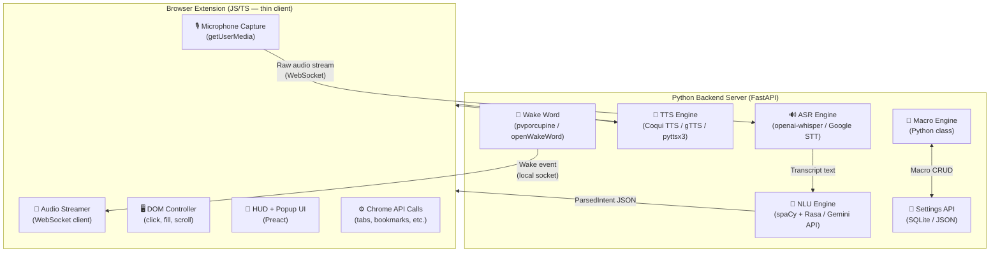
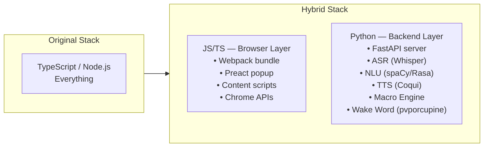

# VORDI — Python Replacement Analysis

> [!IMPORTANT]
> **The core truth:** A browser extension's **UI, DOM control, and Chrome API calls** are permanently locked to JavaScript — browsers will never execute Python directly. However, **every intelligence layer** (ASR, NLU, TTS, Wake Word, Macro Engine) **can be moved to a Python backend**, turning VORDI into a **hybrid architecture**.

---

## The Fundamental Split

```mermaid
flowchart LR
    subgraph BROWSER["🌐 Browser Side — MUST be JavaScript"]
        J1["Popup UI"]
        J2["Content Script\n(DOM Control)"]
        J3["Chrome Extension APIs"]
        J4["HUD Overlay"]
        J5["Element Picker"]
        J6["Message Bus"]
    end

    subgraph PYTHON["🐍 Python Backend — CAN replace JS"]
        P1["ASR Engine"]
        P2["NLU / Intent Engine"]
        P3["TTS Engine"]
        P4["Wake Word Detection"]
        P5["Macro Engine"]
        P6["Settings API"]
        P7["Build & CI Scripts"]
    end

    BROWSER <-->|"WebSocket / REST\n(localhost or cloud)"| PYTHON
```



---

## Category-by-Category Replacement Table

### 🔴 CANNOT Be Replaced by Python (Browser-Locked)

| Tool / Library | Why It's JS-Only | Python Alternative | Verdict |
|---|---|---|---|
| **Webpack 5** | Bundles JS/TS/CSS for browser extension manifest | None — Python can't bundle browser extensions | ❌ Irreplaceable |
| **TypeScript** | Extension source language (browsers only run JS) | None for browser code | ❌ Irreplaceable |
| **Preact (UI)** | Renders popup HTML/CSS inside browser | None — browsers don't render Python | ❌ Irreplaceable |
| **Chrome Extension APIs** (`chrome.tabs`, `chrome.storage`, etc.) | Only accessible via browser's JS runtime | None | ❌ Irreplaceable |
| **Content Scripts** (DOM control) | Only JS can manipulate a live webpage DOM | None | ❌ Irreplaceable |
| **Web Speech API** | Browser-native JS API | Python can run ASR **server-side** instead | ⚠️ Architecturally shift |
| **Web SpeechSynthesis API** | Browser-native TTS | Python can run TTS **server-side** | ⚠️ Architecturally shift |
| **WebCrypto API** | Browser-native encryption | Python handles encryption server-side | ⚠️ Architecturally shift |
| **webextension-polyfill** | Firefox shim — must be JS | None | ❌ Irreplaceable |
| **@types/chrome** | TypeScript definitions | None | ❌ Irreplaceable (dev-only) |
| **css-loader / style-loader** | Webpack plugins for browser CSS | None | ❌ Irreplaceable |
| **ESLint / Prettier** | JS/TS linting + formatting | Python has `ruff`, `black` for Python files | 🔵 Partial (JS still needs ESLint) |
| **jsdom / Playwright** | DOM/browser environment simulation | Playwright has Python bindings! | ✅ Partial replacement |

---

### 🟢 CAN Be Fully Replaced by Python

| Original JS Tool | Python Replacement | Library | Notes |
|---|---|---|---|
| **OpenAI Whisper API (npm)** | `openai` Python SDK | `pip install openai` | Identical API, same key |
| **@xenova/transformers (Whisper WASM)** | HuggingFace Transformers | `pip install transformers` | Much better Python support |
| **whisper.cpp WASM** | OpenAI Whisper (Python) | `pip install openai-whisper` | Native Python, GPU support |
| **Google Cloud STT SDK** | Google Cloud Speech | `pip install google-cloud-speech` | Full parity |
| **@google/generative-ai (Gemini SDK)** | Google Generative AI | `pip install google-generativeai` | Full parity |
| **openai (NLU calls)** | OpenAI Python SDK | `pip install openai` | Full parity |
| **@picovoice/porcupine-web** | Porcupine Python SDK | `pip install pvporcupine` | Same engine, Python bindings |
| **Fuse.js (fuzzy matching)** | RapidFuzz / TheFuzz | `pip install rapidfuzz` | Actually **more powerful** |
| **fastest-levenshtein** | python-Levenshtein | `pip install Levenshtein` | Same algorithm |
| **Custom Regex NLU Engine** | spaCy / NLTK / Rasa | `pip install spacy` | Far **more powerful** |
| **Vitest (unit tests)** | Pytest | `pip install pytest` | For Python backend tests |
| **sinon / sinon-chrome** | unittest.mock | Built-in Python stdlib | Full mock support |
| **dotenv** | python-dotenv | `pip install python-dotenv` | Identical functionality |
| **uuid** | uuid module | Built-in Python stdlib | `import uuid` |
| **npm audit** | Safety / pip-audit | `pip install pip-audit` | Equivalent vulnerability scan |
| **Snyk** | Snyk (has Python support) | Same tool | Same service, Python scanning |
| **semantic-release scripts** | Python release scripts | `pip install bump2version` | Custom Python scripts |
| **Build/CI utility scripts** | Python scripts | stdlib + `subprocess` | Replace JS helper scripts |
| **sharp (image resize)** | Pillow | `pip install Pillow` | More powerful image processing |
| **Postman / curl** | httpx / requests | `pip install httpx` | Better for automated API testing |

---

### 🟡 PARTIALLY Replaceable

| Original JS Tool | Python Equivalent | Coverage | What Still Needs JS |
|---|---|---|---|
| **Playwright (E2E tests)** | `playwright` (Python) | ~90% | Extension-loading setup still needs JS config |
| **Husky (git hooks)** | `pre-commit` framework | ~100% | `pip install pre-commit` |
| **commitlint** | `commitizen` | ~100% | `pip install commitizen` |
| **GitHub Actions CI** | Same YAML, Python steps | ~100% | The extension build step still runs `npm run build` |
| **web-ext (Firefox linter)** | Partially — `web-ext` has no Python clone | ~20% | Still need Node.js for `web-ext lint` |
| **zip-webpack-plugin** | Python `zipfile` stdlib | ~100% | The Webpack build itself still needs Node |

---

## The Hybrid Architecture (Recommended)

> [!NOTE]
> This is the **best real-world design** — keep the browser extension as a lightweight JS shell, and move all the AI/intelligence to a Python backend server.



---

## Full Python Stack (Backend Only)

### Core Framework

| Purpose | Library | Install | Notes |
|---|---|---|---|
| **Backend API Server** | FastAPI | `pip install fastapi uvicorn` | Async, WebSocket support, auto-docs |
| **WebSocket Server** | websockets | `pip install websockets` | Real-time audio streaming |
| **Task Queue** | Celery | `pip install celery redis` | Background macro execution |
| **Settings Storage** | SQLite (built-in) + SQLAlchemy | `pip install sqlalchemy` | Local DB for macros, settings |
| **Environment Vars** | python-dotenv | `pip install python-dotenv` | .env file support |

### ASR (Speech-to-Text)

| Purpose | Library | Install | Notes |
|---|---|---|---|
| **Offline ASR (best)** | openai-whisper | `pip install openai-whisper` | Runs locally, GPU accelerated |
| **Fast offline ASR** | faster-whisper | `pip install faster-whisper` | 4x faster than original Whisper |
| **Cloud ASR (OpenAI)** | openai | `pip install openai` | Whisper API calls |
| **Cloud ASR (Google)** | google-cloud-speech | `pip install google-cloud-speech` | Streaming STT |
| **Multi-source abstraction** | SpeechRecognition | `pip install SpeechRecognition` | Wraps Google, Whisper, Sphinx |
| **Microphone capture** | PyAudio | `pip install pyaudio` | Low-level mic access on server |
| **Audio processing** | librosa / soundfile | `pip install librosa soundfile` | Audio preprocessing, VAD |
| **Voice Activity Detection** | webrtcvad | `pip install webrtcvad` | Detect end of utterance |

### NLU (Natural Language Understanding)

| Purpose | Library | Install | Notes |
|---|---|---|---|
| **Production NLU** | Rasa NLU | `pip install rasa` | Full intent + entity pipeline, local |
| **NLP powerhouse** | spaCy | `pip install spacy` | Named entity recognition, dep parsing |
| **Transformers / LLM** | transformers (HuggingFace) | `pip install transformers` | Local LLM intent classification |
| **LLM API (Gemini)** | google-generativeai | `pip install google-generativeai` | Cloud NLU fallback |
| **LLM API (OpenAI)** | openai | `pip install openai` | GPT-4o NLU fallback |
| **Fuzzy matching** | rapidfuzz | `pip install rapidfuzz` | Element label matching |
| **Regex patterns** | Built-in `re` module | stdlib | Rule-based intent matching |
| **Number word parsing** | word2number | `pip install word2number` | "three" → 3 |
| **URL normalization** | tldextract | `pip install tldextract` | "github dot com" → github.com |

### TTS (Text-to-Speech)

| Purpose | Library | Install | Notes |
|---|---|---|---|
| **Local TTS (best quality)** | Coqui TTS | `pip install TTS` | Neural voices, offline |
| **Simple local TTS** | pyttsx3 | `pip install pyttsx3` | System voices, zero config |
| **Google TTS** | gTTS | `pip install gTTS` | Google's voices, requires internet |
| **Cloud TTS (Google)** | google-cloud-texttospeech | `pip install google-cloud-texttospeech` | Premium voices |
| **ElevenLabs** | elevenlabs | `pip install elevenlabs` | Most human-like voices (paid) |

### Wake Word Detection

| Purpose | Library | Install | Notes |
|---|---|---|---|
| **Production wake word** | pvporcupine | `pip install pvporcupine` | Same engine as JS SDK |
| **Open source alternative** | openWakeWord | `pip install openwakeword` | Fully free, trainable |
| **DIY wake word** | speechbrain | `pip install speechbrain` | Train custom keyword spotting |

### Testing (Python Backend)

| Purpose | Library | Install | Notes |
|---|---|---|---|
| **Unit / Integration tests** | pytest | `pip install pytest` | Industry standard |
| **Async test support** | pytest-asyncio | `pip install pytest-asyncio` | Test FastAPI async routes |
| **HTTP client for tests** | httpx | `pip install httpx` | Test REST endpoints |
| **Mocking** | unittest.mock | Built-in stdlib | Mock ASR/LLM API calls |
| **Coverage** | pytest-cov | `pip install pytest-cov` | Code coverage reports |
| **E2E browser tests** | playwright (Python) | `pip install playwright` | Browser automation |

### Code Quality (Python)

| Purpose | Library | Install | Notes |
|---|---|---|---|
| **Linter + formatter** | ruff | `pip install ruff` | Blazing fast, replaces flake8+black |
| **Type checking** | mypy | `pip install mypy` | Static type analysis |
| **Git hooks** | pre-commit | `pip install pre-commit` | Replaces Husky |
| **Commit messages** | commitizen | `pip install commitizen` | Replaces commitlint |
| **Versioning** | bump2version | `pip install bump2version` | Semantic versioning |
| **Security scan** | pip-audit | `pip install pip-audit` | Replaces npm audit |
| **Dependency management** | Poetry | `pip install poetry` | Replaces package.json for Python |
| **Virtual environments** | venv / conda | Built-in Python | Isolate dependencies |

### Image / Asset Processing

| Purpose | Library | Install | Notes |
|---|---|---|---|
| **Icon resizing** | Pillow | `pip install Pillow` | Replaces sharp |
| **SVG processing** | cairosvg | `pip install cairosvg` | SVG → PNG conversion |

---

## Revised Stack Comparison



| Metric | Pure JS Stack | Hybrid Python Backend |
|---|---|---|
| **NLU Quality** | Rule-based regex + LLM API only | spaCy + Rasa + transformers — far superior |
| **ASR Offline** | whisper.cpp WASM (limited) | faster-whisper with GPU — excellent |
| **TTS Quality** | Browser SpeechSynthesis (robotic) | Coqui TTS (neural, natural) |
| **Wake Word** | Porcupine WASM (good) | pvporcupine Python (identical, easier) |
| **Dev Ergonomics** | TypeScript everywhere | Python for AI/ML — natural fit |
| **ML Model Support** | Very limited in browser | Full PyTorch / TensorFlow ecosystem |
| **Latency** | Lower (all in-browser) | +50–200ms network hop (localhost) |
| **Privacy** | Audio stays in browser | Audio goes to local Python server (still private) |
| **Internet Required?** | No (with WASM) | No (localhost Python server) |

---

## What You Still Need Node.js For (Minimum)

Even with Python everywhere, you **cannot eliminate Node.js entirely** for a browser extension:

```
Node.js is still required for:
  ✗ webpack (bundles the JS extension)
  ✗ TypeScript compiler (tsc)
  ✗ ESLint (lints JS/TS source)
  ✗ web-ext (Firefox extension linter/builder)
  ✗ Preact/JSX compilation
  ✗ chrome.storage / chrome.tabs (browser runtime)

Minimum Node dependencies you can NEVER remove:
  - node + npm (or pnpm)
  - typescript
  - webpack + ts-loader
  - @types/chrome
  - preact
  - webextension-polyfill
  - web-ext (for Firefox)
```

> [!WARNING]
> There is **no way to build a browser extension without Node.js** today. Python can own the backend intelligence, but the extension shell always needs a JS build toolchain.

---

## Recommended Final Architecture

| Layer | Language | Responsibility |
|---|---|---|
| **Extension Shell** | JavaScript / TypeScript | Mic capture, DOM control, Chrome APIs, UI |
| **Intelligence Backend** | Python (FastAPI) | ASR, NLU, TTS, Wake Word, Macros |
| **Communication** | WebSocket (audio) + REST (commands) | Localhost, no internet needed |
| **Storage** | `chrome.storage` (JS) + SQLite (Python) | Settings in browser, macros in Python DB |
| **Build System** | Webpack (JS side) + Poetry (Python side) | Separate build pipelines |
| **Testing** | Vitest (JS) + Pytest (Python) | Each layer tested in its native language |
| **CI/CD** | GitHub Actions | Single pipeline runs both |

---

## Python-Only Minimum Install

```bash
# Create virtual environment
python -m venv vordi-env
source vordi-env/bin/activate  # Windows: vordi-env\Scripts\activate

# Backend server
pip install fastapi uvicorn websockets python-dotenv

# ASR
pip install faster-whisper SpeechRecognition pyaudio webrtcvad

# NLU
pip install spacy rapidfuzz word2number tldextract google-generativeai
python -m spacy download en_core_web_sm

# TTS
pip install pyttsx3 gTTS

# Wake word
pip install pvporcupine openwakeword

# Testing + quality
pip install pytest pytest-asyncio httpx pytest-cov ruff mypy pre-commit

# Utilities
pip install sqlalchemy pillow bump2version pip-audit poetry
```
