# System Design Document (SDD)
## VORDI — Voice-Operated Browser Control Extension

| Field | Value |
|---|---|
| **Document Version** | 1.0.0 |
| **Status** | Draft |
| **Date** | November 7, 2026 |
| **Author** | Software Architecture Team |
| **Preceding Document** | SRS v1.0.0 |

---

## Table of Contents

1. [Design Goals & Principles](#1-design-goals--principles)
2. [High-Level Architecture](#2-high-level-architecture)
3. [Component Design](#3-component-design)
   - 3.1 Wake Word Engine
   - 3.2 ASR Module
   - 3.3 NLU Engine
   - 3.4 Action Dispatcher
   - 3.5 Browser API Handler
   - 3.6 Content Script & DOM Controller
   - 3.7 TTS Module
   - 3.8 Macro Engine
   - 3.9 Settings & State Store
   - 3.10 UI Layer
4. [Data Models](#4-data-models)
5. [API Contracts (Internal Message Bus)](#5-api-contracts-internal-message-bus)
6. [State Machines](#6-state-machines)
7. [NLU Intent System Design](#7-nlu-intent-system-design)
8. [DOM Interaction Strategy](#8-dom-interaction-strategy)
9. [Security Design](#9-security-design)
10. [Extension File Structure](#10-extension-file-structure)
11. [Technology Stack](#11-technology-stack)
12. [Error Handling Strategy](#12-error-handling-strategy)
13. [Performance Design](#13-performance-design)
14. [Deployment & Packaging](#14-deployment--packaging)

---

## 1. Design Goals & Principles

| Principle | Description |
|---|---|
| **Offline-First** | Core commands work without internet using local ASR + rule-based NLU |
| **Modular Pipeline** | Each stage (ASR → NLU → Dispatch → Execute) is independently swappable |
| **Low Latency** | Command-to-action under 1.5s end-to-end for P1 commands |
| **Fail Gracefully** | Every failure path has a voice + visual fallback |
| **Privacy by Default** | No audio leaves device unless user explicitly opts into cloud mode |
| **MV3 Compliant** | Built entirely on Service Workers, no persistent background pages |
| **Data-Driven Intents** | New voice commands added via JSON config — no code changes required |

---

## 2. High-Level Architecture

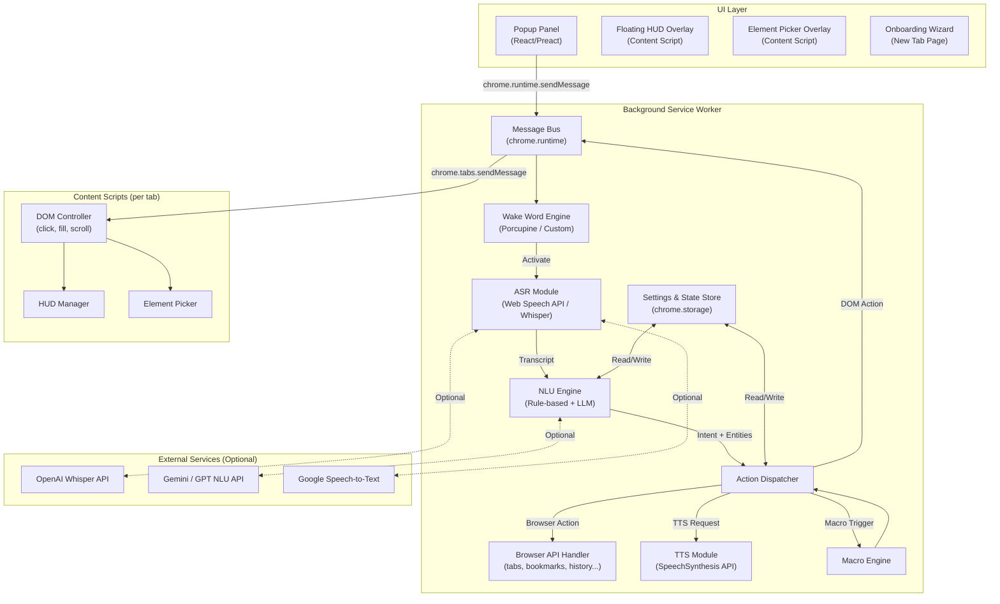

---

## 3. Component Design

### 3.1 Wake Word Engine

**Purpose:** Detect the trigger phrase *"Hey VORDI"* locally and always-on without sending audio to any service.

**Design:**

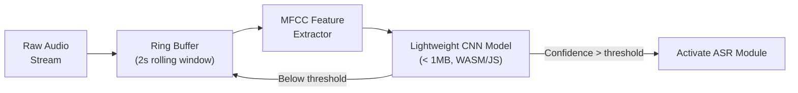

**Key Design Decisions:**

| Decision | Choice | Rationale |
|---|---|---|
| Engine | Porcupine Web SDK (primary) / Custom TF.js model (fallback) | Porcupine is industry-standard, free tier available; TF.js as offline fallback |
| Processing | Web Audio API `AudioWorkletProcessor` | Low-latency, off-main-thread audio processing |
| Model Size | ≤ 1 MB WASM bundle | Minimal extension size impact |
| False Positive Rate | < 1 per hour target | Configurable sensitivity slider in settings |
| Power Mode | Audio processing only on `AudioWorklet`; no polling timers | Minimal CPU drain |

**Interface:**

```typescript
interface WakeWordEngine {
  start(): Promise<void>;
  stop(): void;
  onDetected(callback: () => void): void;
  setSensitivity(level: 0 | 1 | 2): void; // low, medium, high
}
```

---

### 3.2 ASR Module

**Purpose:** Convert the user's spoken command (after wake word) into a text transcript.

**Design — Multi-Provider Strategy:**

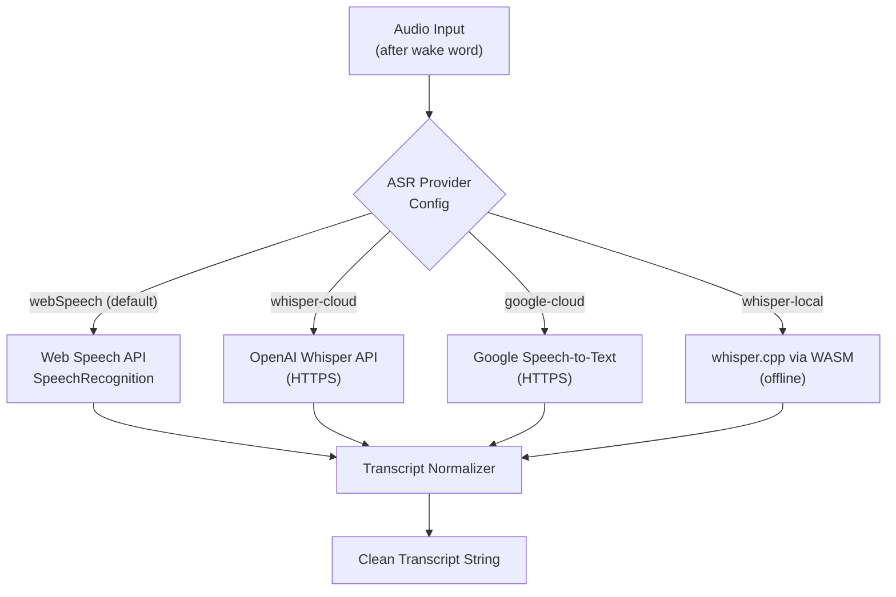

**ASR Module Class Design:**

```typescript
interface ASRProvider {
  transcribe(audioBlob: Blob): Promise<TranscriptResult>;
  isAvailable(): boolean;
}

interface TranscriptResult {
  transcript: string;        // e.g., "go to github dot com"
  confidence: number;        // 0.0 – 1.0
  isFinal: boolean;
  durationMs: number;
}

class ASRModule {
  private provider: ASRProvider;
  private normalizer: TranscriptNormalizer;

  constructor(config: ASRConfig) { ... }
  async transcribe(audioStream: MediaStream): Promise<TranscriptResult> { ... }
  switchProvider(name: ASRProviderName): void { ... }
}
```

**Transcript Normalization Rules:**

| Raw Input | Normalized Output |
|---|---|
| "go to github dot com" | "go to github.com" |
| "open new tab" | "open new tab" |
| "type john at gmail dot com" | "type john@gmail.com" |
| "press enter" | "press enter" |
| "scroll down fifty percent" | "scroll down 50%" |

---

### 3.3 NLU Engine

**Purpose:** Parse the normalized transcript into a structured `Intent` object with named entities.

**Two-tier Architecture:**

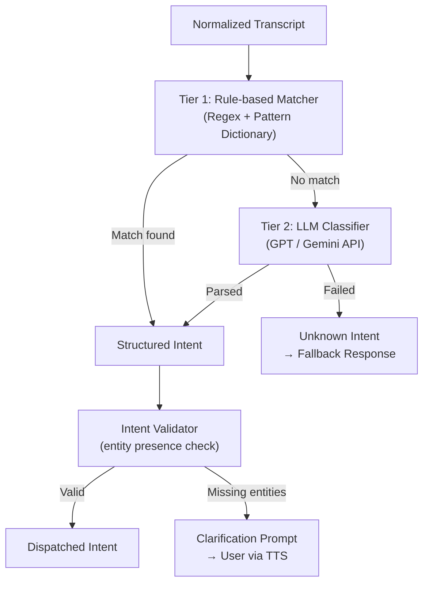

**Intent Schema:**

```typescript
interface ParsedIntent {
  intentId: string;           // e.g., "NAV_GO_TO_URL"
  category: IntentCategory;   // NAVIGATION | TAB | DOM | SEARCH | BOOKMARK | TTS | MACRO | SETTINGS
  confidence: number;         // 0.0 – 1.0
  entities: Record<string, string>; // e.g., { url: "github.com", tab_index: "3" }
  rawTranscript: string;
  resolvedBy: "rules" | "llm";
}

type IntentCategory =
  | "NAVIGATION"
  | "TAB_MANAGEMENT"
  | "DOM_INTERACTION"
  | "SEARCH"
  | "BOOKMARK"
  | "HISTORY"
  | "TTS_READING"
  | "DISPLAY"
  | "MACRO"
  | "ACCESSIBILITY"
  | "SETTINGS";
```

**Intent Registry (JSON-driven, data/intents.json excerpt):**

```json
[
  {
    "id": "NAV_GO_TO_URL",
    "category": "NAVIGATION",
    "patterns": [
      "go to {url}",
      "open {url}",
      "navigate to {url}",
      "take me to {url}"
    ],
    "entities": {
      "url": { "type": "url", "required": true }
    },
    "action": "BROWSER_NAVIGATE",
    "confirmationTemplate": "Navigating to {url}"
  },
  {
    "id": "TAB_SWITCH_BY_INDEX",
    "category": "TAB_MANAGEMENT",
    "patterns": [
      "switch to tab {index}",
      "go to tab {index}",
      "tab {index}"
    ],
    "entities": {
      "index": { "type": "integer", "required": true }
    },
    "action": "TAB_ACTIVATE",
    "confirmationTemplate": "Switching to tab {index}"
  },
  {
    "id": "DOM_CLICK_ELEMENT",
    "category": "DOM_INTERACTION",
    "patterns": [
      "click {target}",
      "press {target}",
      "tap {target}",
      "select {target}"
    ],
    "entities": {
      "target": { "type": "string", "required": true }
    },
    "action": "DOM_CLICK",
    "confirmationTemplate": "Clicking {target}"
  }
]
```

**Entity Types & Extractors:**

| Entity Type | Extraction Strategy |
|---|---|
| `url` | Regex + known site aliases dictionary |
| `integer` | Number word→digit conversion ("three" → 3) |
| `string` | Remainder after pattern matching |
| `keyword` | From a predefined vocabulary list |
| `email` | Regex with dot/at normalization |
| `percentage` | Number + "percent" parsing |

---

### 3.4 Action Dispatcher

**Purpose:** Routes a resolved `ParsedIntent` to the correct handler (Browser API or Content Script), manages response, and triggers feedback.

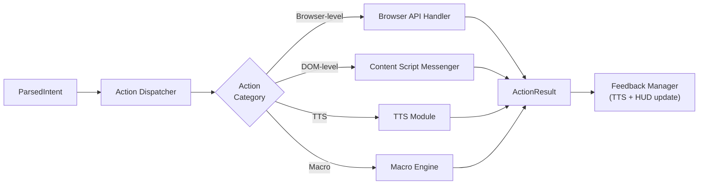

**ActionResult Schema:**

```typescript
interface ActionResult {
  success: boolean;
  intentId: string;
  message: string;             // Human-readable: "Navigated to github.com"
  error?: {
    code: ErrorCode;
    detail: string;
    suggestion?: string;       // "Try saying 'Show clickable elements'"
  };
  data?: Record<string, unknown>; // e.g., { tabId: 5, url: "github.com" }
}

enum ErrorCode {
  ELEMENT_NOT_FOUND   = "ELEMENT_NOT_FOUND",
  AMBIGUOUS_TARGET    = "AMBIGUOUS_TARGET",
  PERMISSION_DENIED   = "PERMISSION_DENIED",
  NAVIGATION_FAILED   = "NAVIGATION_FAILED",
  UNKNOWN_INTENT      = "UNKNOWN_INTENT",
  CONTENT_SCRIPT_ERR  = "CONTENT_SCRIPT_ERR",
}
```

---

### 3.5 Browser API Handler

**Purpose:** Executes all browser-level actions using Chrome Extension APIs.

**Handler Map:**

| Action ID | Chrome API Call |
|---|---|
| `BROWSER_NAVIGATE` | `chrome.tabs.update(tabId, { url })` |
| `BROWSER_BACK` | `chrome.tabs.goBack(tabId)` |
| `BROWSER_FORWARD` | `chrome.tabs.goForward(tabId)` |
| `BROWSER_RELOAD` | `chrome.tabs.reload(tabId)` |
| `TAB_NEW` | `chrome.tabs.create({})` |
| `TAB_CLOSE` | `chrome.tabs.remove(tabId)` |
| `TAB_ACTIVATE` | `chrome.tabs.update(tabId, { active: true })` |
| `TAB_DUPLICATE` | `chrome.tabs.duplicate(tabId)` |
| `TAB_PIN` | `chrome.tabs.update(tabId, { pinned: true })` |
| `TAB_MUTE` | `chrome.tabs.update(tabId, { muted: true })` |
| `TAB_LIST` | `chrome.tabs.query({ currentWindow: true })` |
| `BOOKMARK_ADD` | `chrome.bookmarks.create({ title, url })` |
| `BOOKMARK_OPEN` | `chrome.tabs.update({ url: bookmark.url })` |
| `BOOKMARK_DELETE` | `chrome.bookmarks.remove(id)` |
| `HISTORY_OPEN` | `chrome.tabs.create({ url: 'chrome://history' })` |
| `ZOOM_IN` | `chrome.tabs.setZoom(tabId, currentZoom + 0.1)` |
| `ZOOM_OUT` | `chrome.tabs.setZoom(tabId, currentZoom - 0.1)` |
| `ZOOM_RESET` | `chrome.tabs.setZoom(tabId, 0)` |

---

### 3.6 Content Script & DOM Controller

**Purpose:** Injected into every page to perform DOM-level interactions: element finding, clicking, form filling, scrolling.

**Architecture:**

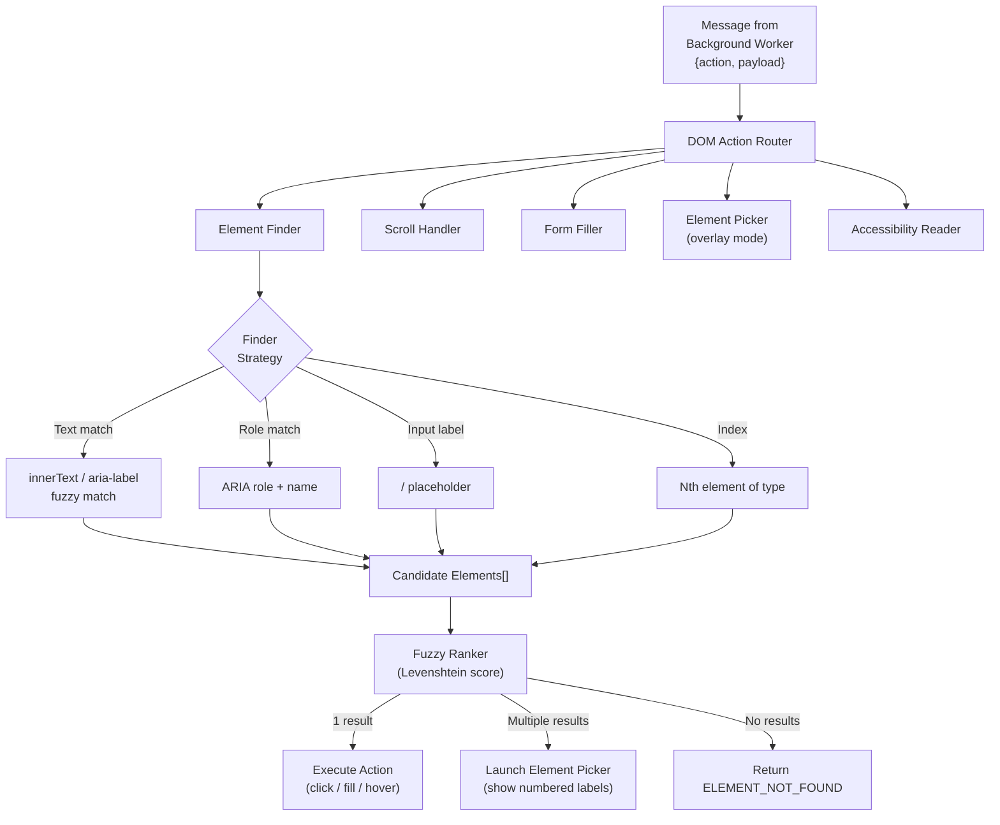

**Element Finder Strategy (priority order):**

1. `aria-label` exact match
2. `innerText` / `textContent` fuzzy match (Levenshtein ≤ 2)
3. `placeholder` attribute match
4. Associated `<label>` text match
5. `name` / `id` attribute match
6. `title` attribute match
7. `alt` attribute (for images)

**DOM Controller API (Content Script):**

```typescript
interface DOMController {
  click(target: string): Promise<DOMActionResult>;
  fill(fieldLabel: string, value: string): Promise<DOMActionResult>;
  scroll(direction: ScrollDirection, amount: ScrollAmount): Promise<DOMActionResult>;
  submit(): Promise<DOMActionResult>;
  selectText(from?: string, to?: string): Promise<DOMActionResult>;
  copy(): Promise<DOMActionResult>;
  paste(text?: string): Promise<DOMActionResult>;
  findOnPage(term: string): Promise<DOMActionResult>;
  showElementPicker(): Promise<DOMActionResult>;
  describeElement(): Promise<DOMActionResult>;
  readPageContent(): Promise<string>;
}

type ScrollDirection = "up" | "down" | "left" | "right" | "top" | "bottom";
type ScrollAmount = "small" | "medium" | "large" | "full" | number; // px or %
```

**Element Picker Overlay:**

When multiple elements match (or user says *"Show clickable elements"*), the DOM Controller:
1. Queries all interactive elements: `a, button, input, select, textarea, [role="button"], [tabindex]`
2. Injects a floating numbered badge (`<div class="vordi-badge">`) next to each element
3. Sends TTS: *"Found 5 elements. Say a number to select."*
4. Listens for a number command → executes the corresponding element's action
5. Cleans up all badges after selection or *"Cancel"*

---

### 3.7 TTS Module

**Purpose:** Provide audio feedback for every action, error, and prompt.

```typescript
interface TTSModule {
  speak(text: string, options?: TTSOptions): Promise<void>;
  stop(): void;
  pause(): void;
  resume(): void;
  readPage(contentSelector?: string): Promise<void>;
  readSelection(): Promise<void>;
  isSpeaking(): boolean;
}

interface TTSOptions {
  rate?: number;      // 0.5 – 2.0 (default: 1.0)
  pitch?: number;     // 0.0 – 2.0 (default: 1.0)
  volume?: number;    // 0.0 – 1.0 (default: 1.0)
  voice?: string;     // SpeechSynthesisVoice name
  interrupt?: boolean; // stop current speech first (default: true)
}
```

**Speech Priority Queue:**

| Priority | Use Case | Example |
|---|---|---|
| P0 (immediate) | Error messages | "Couldn't find that element" |
| P1 (interrupt) | Action confirmation | "Navigating to GitHub" |
| P2 (queue) | Page reading (TTS mode) | Long article text |
| P3 (soft) | HUD transcription echo | Real-time transcript |

---

### 3.8 Macro Engine

**Purpose:** Record, store, name, and replay sequences of voice commands.

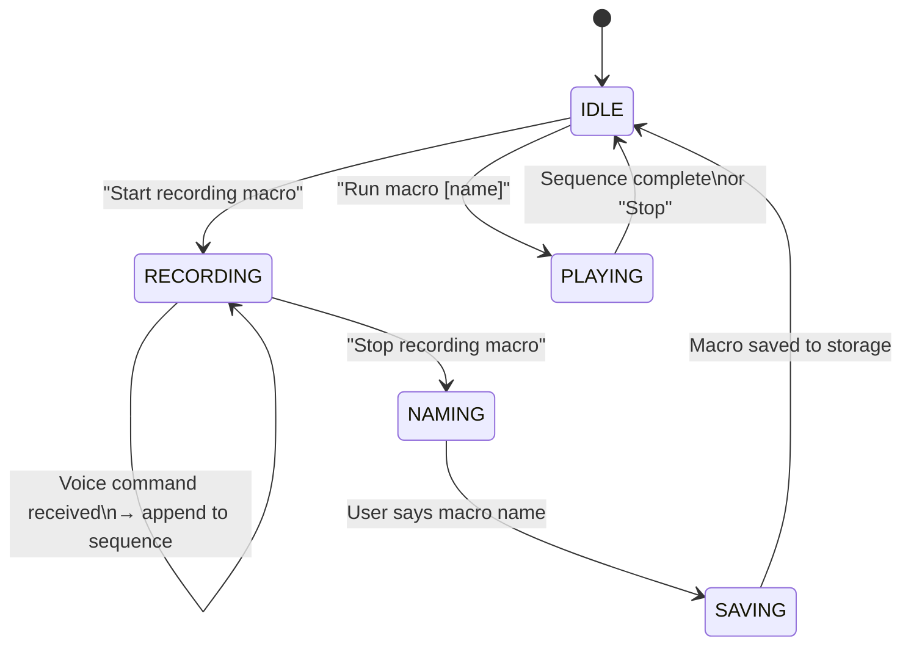

**Macro Storage Schema:**

```typescript
interface Macro {
  id: string;             // UUID
  name: string;           // User-defined: "morning routine"
  createdAt: number;      // Unix timestamp
  commands: MacroStep[];
}

interface MacroStep {
  intentId: string;
  entities: Record<string, string>;
  delayBefore: number;    // ms to wait before this step
  description: string;    // Human-readable: "Navigate to gmail.com"
}
```

**Playback Engine:** Steps are executed sequentially with configurable inter-step delay (default: 800ms). If a step fails, playback pauses and the user is prompted to skip or abort.

---

### 3.9 Settings & State Store

**Purpose:** Centralize all persistent settings, macros, and runtime state across extension lifetime.

**Storage Architecture:**

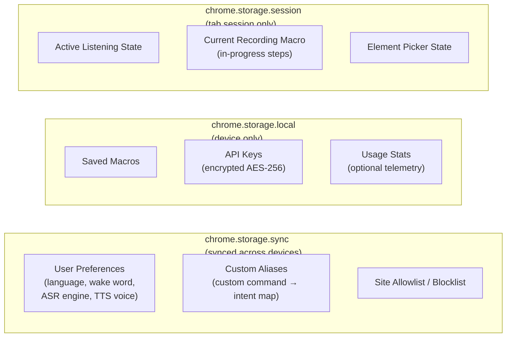

**Settings Schema:**

```typescript
interface VORDISettings {
  general: {
    enabled: boolean;
    language: string;              // "en-US"
    activationMode: "wake-word" | "push-to-talk" | "always-on";
    wakeWord: string;              // "Hey VORDI"
    pushToTalkShortcut: string;    // "Alt+V"
    listenTimeoutSec: number;      // 10
  };
  asr: {
    provider: "web-speech" | "whisper-cloud" | "whisper-local" | "google-cloud";
    silenceThresholdMs: number;    // 1500
    language: string;
  };
  tts: {
    enabled: boolean;
    voice: string;
    rate: number;
    pitch: number;
    volume: number;
    confirmActions: boolean;
  };
  privacy: {
    cloudMode: boolean;
    saveTranscripts: boolean;
  };
  sites: {
    allowlist: string[];
    blocklist: string[];
    defaultPolicy: "allow" | "block";
  };
  display: {
    showHUD: boolean;
    hudPosition: "top-left" | "top-right" | "bottom-left" | "bottom-right";
    showBadge: boolean;            // mic icon on extension badge
  };
  customAliases: CustomAlias[];
}

interface CustomAlias {
  id: string;
  trigger: string;        // "open my dashboard"
  targetIntentId: string; // "NAV_GO_TO_URL"
  entities: Record<string, string>; // { url: "app.mycompany.com/dashboard" }
}
```

---

### 3.10 UI Layer

#### 3.10.1 Popup Panel

Built with **Preact** (lightweight React alternative, ~3KB) for minimal bundle size.

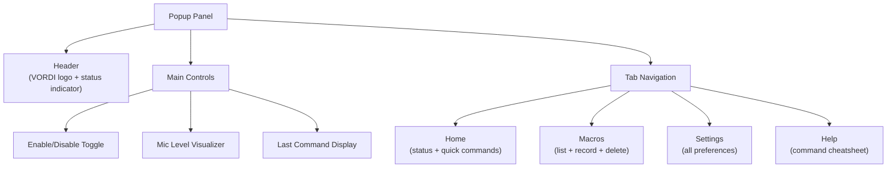

#### 3.10.2 Floating HUD Overlay

- Injected by content script as a **Shadow DOM** component (style isolation)
- Displays: real-time transcript, intent label, action status (pending → success/error)
- Auto-hides after 3 seconds of inactivity
- Draggable, position persisted in `chrome.storage.session`

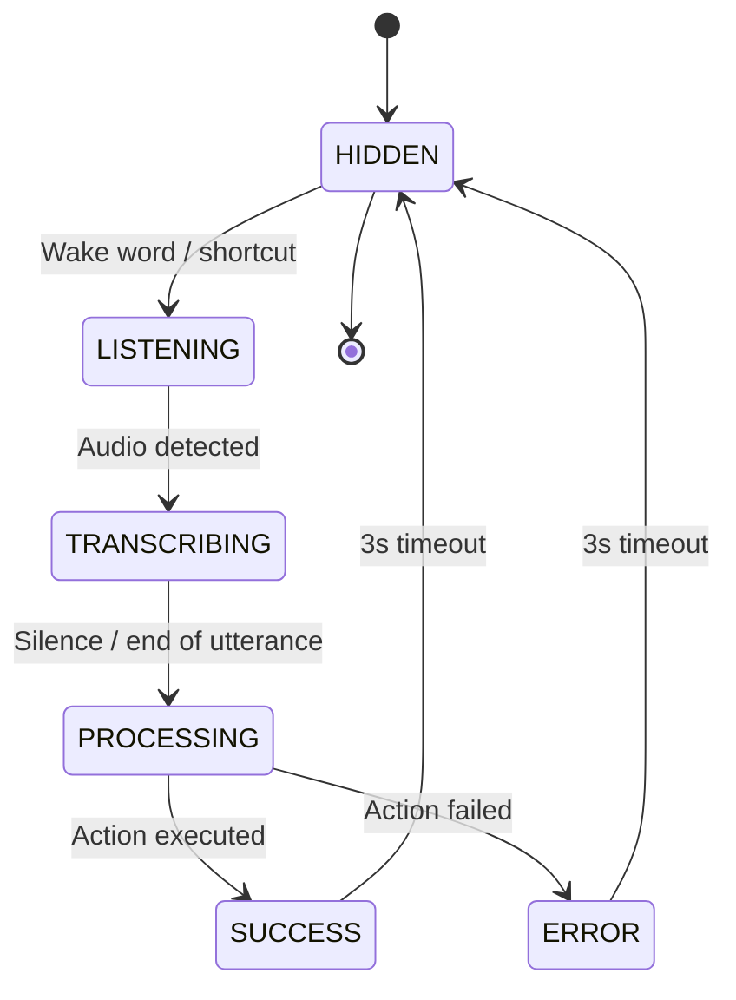

#### 3.10.3 Element Picker Overlay

- Badges rendered as `position: fixed` elements with `z-index: 2147483647`
- Each badge: numbered circle, color-coded by element type (blue=link, green=button, yellow=input)
- Keyboard/voice dismissal supported

---

## 4. Data Models

### 4.1 Entity Relationship Diagram

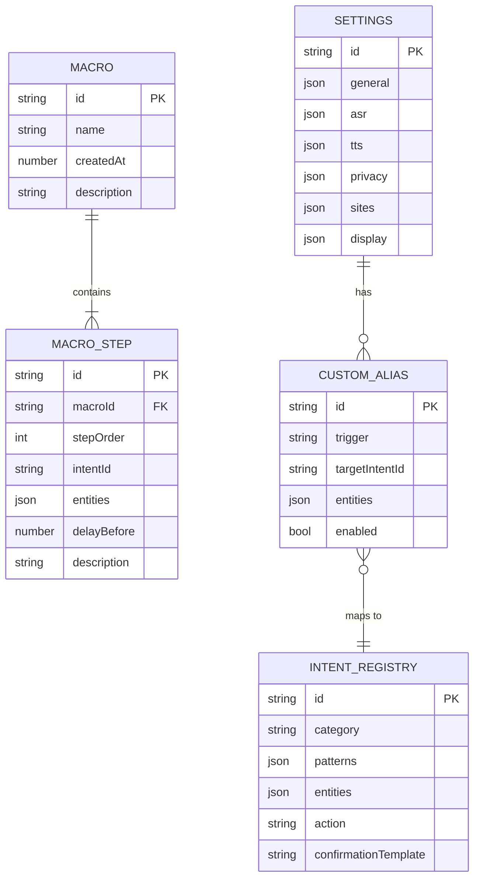

---

## 5. API Contracts (Internal Message Bus)

All communication between extension components uses `chrome.runtime.sendMessage` / `chrome.tabs.sendMessage`. Messages follow a typed envelope schema.

### 5.1 Message Envelope

```typescript
interface VORDIMessage<T = unknown> {
  type: MessageType;
  source: "popup" | "background" | "content" | "offscreen";
  tabId?: number;
  correlationId: string;    // UUID for request-response tracking
  timestamp: number;
  payload: T;
}

type MessageType =
  | "VORDI_ACTIVATE"
  | "VORDI_DEACTIVATE"
  | "TRANSCRIPT_UPDATE"
  | "INTENT_RESOLVED"
  | "EXECUTE_DOM_ACTION"
  | "DOM_ACTION_RESULT"
  | "EXECUTE_BROWSER_ACTION"
  | "BROWSER_ACTION_RESULT"
  | "TTS_SPEAK"
  | "TTS_STOP"
  | "HUD_UPDATE"
  | "ELEMENT_PICKER_START"
  | "ELEMENT_PICKER_RESULT"
  | "MACRO_RECORD_START"
  | "MACRO_RECORD_STOP"
  | "MACRO_PLAY"
  | "SETTINGS_CHANGED"
  | "ERROR";
```

### 5.2 Key Message Payloads

**`EXECUTE_DOM_ACTION`** (Background → Content Script):

```typescript
interface DOMActionPayload {
  action: "CLICK" | "FILL" | "SCROLL" | "SELECT" | "COPY" | "PASTE" | "FIND" | "SUBMIT" | "DESCRIBE";
  target?: string;        // element label for CLICK/FILL
  value?: string;         // text value for FILL/PASTE
  scrollDir?: ScrollDirection;
  scrollAmount?: ScrollAmount;
  searchTerm?: string;    // for FIND
}
```

**`HUD_UPDATE`** (Background → Content Script):

```typescript
interface HUDUpdatePayload {
  state: "listening" | "transcribing" | "processing" | "success" | "error" | "hidden";
  transcript?: string;
  intentLabel?: string;
  message?: string;
  duration?: number;      // ms before auto-hide
}
```

**`TRANSCRIPT_UPDATE`** (Background → Popup & Content Script):

```typescript
interface TranscriptUpdatePayload {
  transcript: string;
  isFinal: boolean;
  confidence: number;
}
```

---

## 6. State Machines

### 6.1 Core Listening State Machine

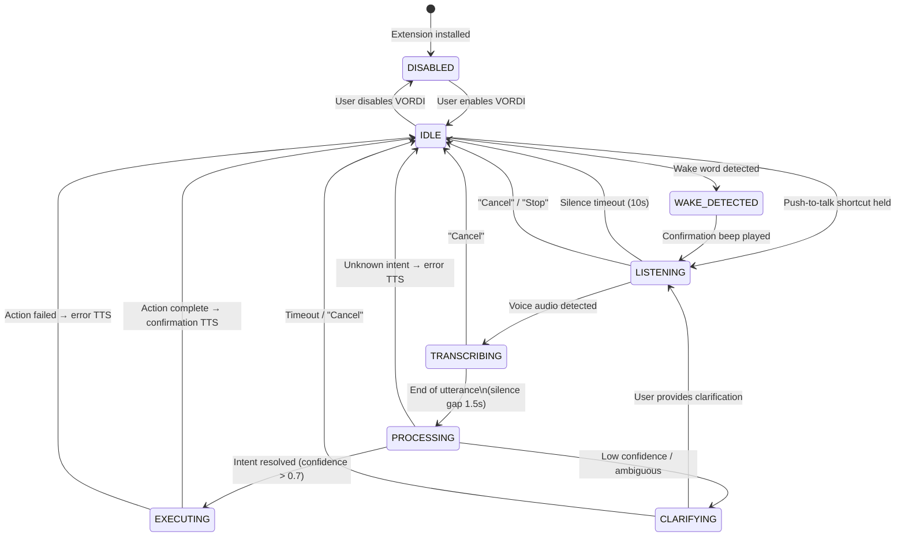

### 6.2 Element Picker State Machine

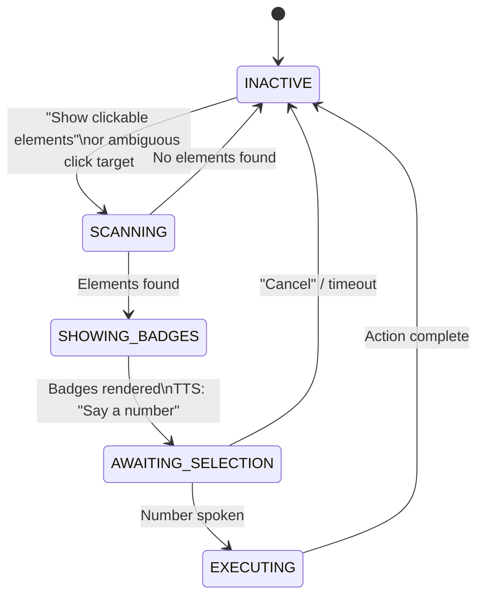

---

## 7. NLU Intent System Design

### 7.1 Two-Tier Processing

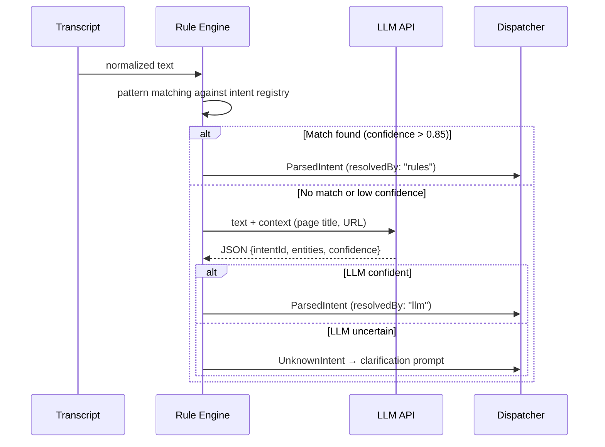

### 7.2 LLM Prompt Template

```
You are VORDI, a browser control assistant. Parse the user's voice command into a structured intent.

Available intents: {intent_list}
Current page: {page_title} at {page_url}
Open tabs: {tab_summary}

User command: "{transcript}"

Respond with JSON only:
{
  "intentId": "<intent id from list>",
  "entities": { "<key>": "<value>" },
  "confidence": <0.0-1.0>,
  "reasoning": "<brief>"
}

If no intent matches, return { "intentId": "UNKNOWN", "confidence": 0 }
```

### 7.3 Context Injection

The NLU Engine enriches every query with browser context to improve accuracy:

```typescript
interface NLUContext {
  pageTitle: string;
  pageUrl: string;
  openTabs: { index: number; title: string; url: string }[];
  recentCommands: string[];     // last 3 commands
  currentFocusedElement?: string;
}
```

---

## 8. DOM Interaction Strategy

### 8.1 Element Finding Algorithm

```typescript
function findElement(target: string, type: ElementType): HTMLElement[] {
  const candidates: ScoredElement[] = [];
  const all = document.querySelectorAll(INTERACTIVE_SELECTOR);

  for (const el of all) {
    const score = computeMatchScore(el, target, type);
    if (score > MATCH_THRESHOLD) {
      candidates.push({ el, score });
    }
  }

  return candidates
    .sort((a, b) => b.score - a.score)
    .slice(0, MAX_CANDIDATES)
    .map(c => c.el);
}

function computeMatchScore(el: Element, target: string, type: ElementType): number {
  let score = 0;
  const checks = [
    { attr: el.getAttribute("aria-label"),   weight: 10 },
    { attr: el.textContent?.trim(),           weight: 8  },
    { attr: el.getAttribute("placeholder"),   weight: 7  },
    { attr: getLabelText(el),                 weight: 9  },
    { attr: el.getAttribute("title"),         weight: 5  },
    { attr: el.getAttribute("name"),          weight: 4  },
    { attr: el.getAttribute("id"),            weight: 3  },
  ];

  for (const { attr, weight } of checks) {
    if (!attr) continue;
    const sim = fuzzyScore(attr.toLowerCase(), target.toLowerCase());
    score = Math.max(score, sim * weight);
  }

  return score;
}
```

### 8.2 Form Filling Strategy

1. Find `<input>`, `<textarea>`, or `<select>` by label association
2. Focus the element: `element.focus()`
3. Set value: `element.value = text`
4. Dispatch synthetic events in order: `input` → `change` → `keyup`
   - This ensures React/Vue/Angular reactive forms detect the change
5. For `<select>`: find `<option>` by fuzzy text match

### 8.3 Shadow DOM Handling

- Content script checks `element.shadowRoot` and recurses into shadow trees
- Maintains a `shadowRoots[]` registry for elements discovered via `composedPath()`

---

## 9. Security Design

### 9.1 Defense-in-Depth Architecture

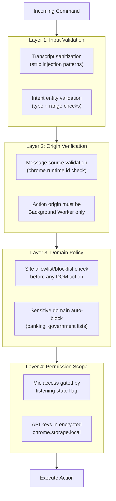

### 9.2 Sensitive Domain Auto-Block List (default)

The following domain patterns are blocked from DOM interaction by default:

```json
[
  "*.bank",
  "*.gov",
  "paypal.com",
  "account.google.com",
  "accounts.microsoft.com",
  "appleid.apple.com",
  "signin.aws.amazon.com"
]
```

Users can manually allowlist these in Settings.

### 9.3 API Key Storage

```typescript
class SecureStorage {
  async saveAPIKey(service: string, key: string): Promise<void> {
    const encrypted = await this.encrypt(key);
    await chrome.storage.local.set({ [`apiKey_${service}`]: encrypted });
  }

  async getAPIKey(service: string): Promise<string | null> {
    const data = await chrome.storage.local.get(`apiKey_${service}`);
    if (!data[`apiKey_${service}`]) return null;
    return this.decrypt(data[`apiKey_${service}`]);
  }

  private async encrypt(text: string): Promise<string> {
    // AES-256-GCM via WebCrypto API
    const key = await this.getDerivedKey();
    // ... SubtleCrypto implementation
  }
}
```

---

## 10. Extension File Structure

```
vordi-extension/
├── manifest.json                  # MV3 manifest
├── package.json
├── tsconfig.json
├── webpack.config.js
│
├── src/
│   ├── background/                # Service Worker
│   │   ├── index.ts               # Service Worker entry point
│   │   ├── wake-word/
│   │   │   ├── WakeWordEngine.ts
│   │   │   └── porcupine.wasm
│   │   ├── asr/
│   │   │   ├── ASRModule.ts
│   │   │   ├── providers/
│   │   │   │   ├── WebSpeechProvider.ts
│   │   │   │   ├── WhisperCloudProvider.ts
│   │   │   │   ├── WhisperLocalProvider.ts
│   │   │   │   └── GoogleSTTProvider.ts
│   │   │   └── TranscriptNormalizer.ts
│   │   ├── nlu/
│   │   │   ├── NLUEngine.ts
│   │   │   ├── RuleBasedMatcher.ts
│   │   │   ├── LLMClassifier.ts
│   │   │   ├── EntityExtractor.ts
│   │   │   └── IntentValidator.ts
│   │   ├── dispatcher/
│   │   │   ├── ActionDispatcher.ts
│   │   │   ├── BrowserAPIHandler.ts
│   │   │   └── FeedbackManager.ts
│   │   ├── tts/
│   │   │   └── TTSModule.ts
│   │   ├── macro/
│   │   │   └── MacroEngine.ts
│   │   ├── storage/
│   │   │   ├── SettingsStore.ts
│   │   │   └── SecureStorage.ts
│   │   └── messaging/
│   │       └── MessageBus.ts
│   │
│   ├── content/                   # Content Scripts
│   │   ├── index.ts               # Content script entry
│   │   ├── dom/
│   │   │   ├── DOMController.ts
│   │   │   ├── ElementFinder.ts
│   │   │   ├── FormFiller.ts
│   │   │   ├── ScrollHandler.ts
│   │   │   └── ShadowDOMTraverser.ts
│   │   ├── hud/
│   │   │   ├── HUDManager.ts
│   │   │   └── HUD.css
│   │   └── picker/
│   │       ├── ElementPicker.ts
│   │       └── Picker.css
│   │
│   ├── popup/                     # Extension Popup
│   │   ├── index.html
│   │   ├── index.tsx              # Preact entry
│   │   ├── components/
│   │   │   ├── App.tsx
│   │   │   ├── StatusPanel.tsx
│   │   │   ├── MacroList.tsx
│   │   │   ├── SettingsPanel.tsx
│   │   │   └── HelpPanel.tsx
│   │   └── popup.css
│   │
│   ├── onboarding/                # First-run wizard
│   │   ├── index.html
│   │   └── index.tsx
│   │
│   └── data/
│       ├── intents.json           # Intent registry
│       ├── site-aliases.json      # "YouTube" → "youtube.com"
│       └── sensitive-domains.json # Auto-block list
│
├── assets/
│   ├── icons/
│   │   ├── icon-16.png
│   │   ├── icon-32.png
│   │   ├── icon-48.png
│   │   └── icon-128.png
│   └── audio/
│       ├── activate.mp3           # Wake word confirmation beep
│       └── error.mp3
│
└── tests/
    ├── nlu/
    │   ├── RuleBasedMatcher.test.ts
    │   └── EntityExtractor.test.ts
    ├── dom/
    │   ├── ElementFinder.test.ts
    │   └── FormFiller.test.ts
    └── dispatcher/
        └── ActionDispatcher.test.ts
```

---

## 11. Technology Stack

| Layer | Technology | Justification |
|---|---|---|
| **Language** | TypeScript | Type safety across all inter-component messages |
| **Build Tool** | Webpack 5 | MV3 compliant bundling, tree shaking, WASM support |
| **UI Framework** | Preact | React-compatible, ~3KB — minimal popup bundle |
| **Wake Word** | Porcupine Web SDK | Industry-standard, local, < 1MB |
| **ASR (primary)** | Web Speech API | Built-in, zero bundle cost, good accuracy |
| **ASR (cloud)** | OpenAI Whisper API | High accuracy, paid tier |
| **ASR (offline)** | whisper.cpp via WASM | Fully local, medium accuracy |
| **NLU (rules)** | Custom Regex Engine | Zero latency, 100% offline |
| **NLU (cloud)** | Gemini 1.5 Flash API | Fast, cost-effective for complex queries |
| **TTS** | Web SpeechSynthesis API | Built-in, no cost |
| **Fuzzy Matching** | Custom Levenshtein + BM25 | No external dependencies |
| **Styling** | CSS Modules + Shadow DOM | Style isolation for injected UI |
| **Testing** | Vitest + jsdom | Fast unit tests, DOM simulation |
| **Linting** | ESLint + Prettier | Code quality |

---

## 12. Error Handling Strategy

### 12.1 Error Taxonomy

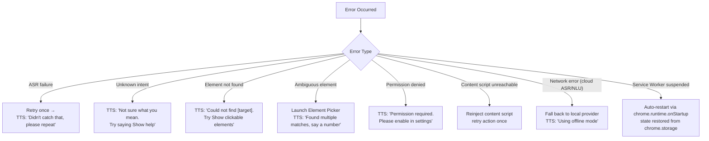

### 12.2 Retry Policy

| Operation | Max Retries | Backoff |
|---|---|---|
| ASR transcription | 1 | None (immediate) |
| Cloud NLU API call | 2 | Exponential (500ms, 1000ms) |
| Content script message | 2 | 300ms fixed |
| Browser API call | 1 | None |

---

## 13. Performance Design

### 13.1 Latency Budget

```
Total target: ≤ 1500ms (command spoken → action starts)

[Wake word detection]:   ≤  50ms  (always running, local)
[ASR transcription]:     ≤ 800ms  (Web Speech API, real-time)
[NLU processing]:        ≤ 150ms  (rule-based) | ≤ 600ms (LLM)
[Action dispatch]:       ≤  50ms  (message routing)
[Browser/DOM action]:    ≤ 300ms  (Chrome API + DOM manipulation)
[TTS confirmation]:      ≤ 100ms  (queued, non-blocking)

Rule-based path total:   ≤ 1350ms ✅
LLM path total:          ≤ 1900ms (acceptable for complex commands)
```

### 13.2 Optimization Strategies

| Strategy | Detail |
|---|---|
| **Speculative transcription** | Display partial transcript in HUD before final result |
| **Intent caching** | LRU cache of last 20 intent results (same input → skip NLU) |
| **Content script pre-injection** | Inject content script on tab load, not on demand |
| **DOM snapshot caching** | Cache element map for 500ms to avoid repeated DOM scans |
| **TTS non-blocking** | Confirmations queued async; don't block action execution |
| **Bundle splitting** | Separate chunks for wake word WASM, popup, content script |

---

## 14. Deployment & Packaging

### 14.1 Build Process

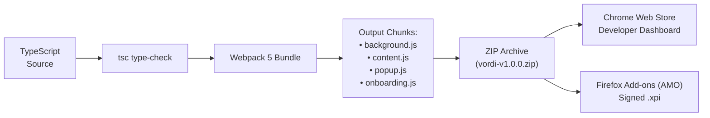

### 14.2 Manifest V3 (manifest.json skeleton)

```json
{
  "manifest_version": 3,
  "name": "VORDI - Voice Browser Control",
  "version": "1.0.0",
  "description": "Control your browser entirely by voice.",
  "permissions": [
    "tabs", "activeTab", "storage", "bookmarks",
    "history", "scripting", "tts"
  ],
  "host_permissions": ["<all_urls>"],
  "background": {
    "service_worker": "background.js",
    "type": "module"
  },
  "content_scripts": [
    {
      "matches": ["<all_urls>"],
      "js": ["content.js"],
      "run_at": "document_idle"
    }
  ],
  "action": {
    "default_popup": "popup/index.html",
    "default_icon": { "128": "assets/icons/icon-128.png" }
  },
  "options_page": "onboarding/index.html",
  "icons": {
    "16": "assets/icons/icon-16.png",
    "32": "assets/icons/icon-32.png",
    "48": "assets/icons/icon-48.png",
    "128": "assets/icons/icon-128.png"
  }
}
```

### 14.3 CI/CD Pipeline

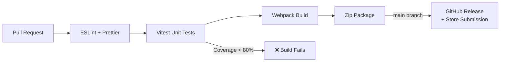

---

> [!NOTE]
> **Document Status:** This SDD covers the full system design for VORDI v1.0. The next phases are:
> - **Phase 3:** UI/UX Wireframes (Popup, HUD, Element Picker, Onboarding)
> - **Phase 4:** Technical PoC — Wire ASR → NLU → Dispatch pipeline
> - **Phase 5:** Sprint 1 — Implement Navigation + Tab Management MVP
