# System Design Document (SDD) v1.1
## VORDI — Voice-Operated Browser Control Extension

| Field | Value |
|---|---|
| **Document Version** | 1.1.0 |
| **Status** | Approved Architectural Specification |
| **Date** | November 7, 2026 |
| **Author** | Software Architecture Team |
| **Preceding Documents** | SRS v1.1, Design Audit Report v1.0 |

---

## Document Change Log (v1.0 → v1.1)

| Audit ID | Issue Resolved | Section(s) Impacted | Description of Architectural Fix |
|---|---|---|---|
| **MISS-01 / CRIT-01** | Missing Offscreen Document & Audio API execution in Service Worker | §2, §3.0, §10, §14 | Added `Offscreen Document` hosting `WakeWordEngine`, `ASRModule`, and `TTSModule`. Service Worker acts solely as coordinator. |
| **CRIT-02** | Service Worker termination sleeping wake word | §3.0, §3.1 | Added Chrome Alarms 24-second keepalive heartbeat pinging and managing the Offscreen Document. |
| **CRIT-03** | Python backend auto-launch failure | §3.10 | Added Native Messaging Host bridge (`com.vordi.backend`) with ephemeral port allocation. |
| **CRIT-04** | Impossible native right-click trigger | §3.4, §3.5 | Removed `DOM_RIGHT_CLICK`; replaced with `DOM_SHOW_OPTIONS` custom floating action HUD overlay. |
| **HIGH-01** | `speechSynthesis` unavailable in Service Worker | §3.0, §3.7 | Moved `TTSModule` into the Offscreen Document; orchestrated via messaging. |
| **HIGH-02** | Clipboard gesture requirement failure | §3.6 | Added `chrome.storage.session` clipboard relay and `document.execCommand` fallback. |
| **HIGH-03** | Macro steps executing before page load | §3.8 | Replaced static delay with `tabs.onUpdated` (`complete` status) and DOM stability observers. |
| **HIGH-04** | React/Vue synthetic event form-filling failure | §8.2 | Implemented native prototype property setter bypass with complete event dispatch cascade. |
| **HIGH-05** | `chrome.storage.session` absent in Firefox | §3.9 | Introduced polymorphic `SessionStore` with fallback to an in-memory Map in Service Worker. |
| **HIGH-06** | Content script failure on `chrome://` & PDF URLs | §3.4, §5.1 | Added pre-dispatch URL scheme validation and 5-second `Promise.race` message timeouts. |
| **MED-01** | Undefined pattern placeholder parsing | §3.3.1 | Formally defined `PatternCompiler` engine translating `{placeholder}` to named capture group regexes. |
| **MED-02** | Undefined `INTERACTIVE_SELECTOR` | §8.1 | Fully defined 17-element interactive query selector covering ARIA roles and standard HTML inputs. |
| **MED-03** | Keyboard shortcut configuration limits | §3.9 | Constrained shortcut settings to a valid enum matching `manifest.json` commands. |
| **MED-04** | Cross-origin iframe DOM blockage | §8.1 | Added origin accessibility detection and `all_frames: true` content script declaration. |
| **MED-05** | Unrealistic latency budget | §13.1 | Multi-tiered latency model (Short Command, Long Command, LLM Fallback). |
| **MED-06** | Absence of Undo mechanism | §3.11 | Added `ActionHistory` stack supporting rollbacks of navigation, tab close, and input changes. |
| **MED-07** | Voice feedback loop during TTS | §3.0, §3.7 | Web Audio API gain ducking during TTS playback plus `echoCancellation: true` stream constraint. |
| **SEC-01** | Python localhost WebSocket unauthenticated | §9.2 | Extension generates UUID session token at install; validates via `Authorization: Bearer` on WS handshake. |
| **SEC-02** | Audio injection attacks via speakers | §9.1 | Echo suppression and explicit voice confirmation prompts for unverified external domain transitions. |

---

## 1. Design Goals & Principles

1. **Manifest V3 Strict Compliance:** Zero persistent background pages. Zero Audio/DOM APIs within the Service Worker.
2. **Audio-Context Isolation:** All microphone capture, wake word inference, ASR processing, and TTS synthesis reside in a managed Offscreen Document.
3. **Resilient Liveness:** Heartbeat alarms prevent Service Worker suspension during voice monitoring sessions.
4. **Deterministic DOM Control:** Framework-agnostic interaction engine that works seamlessly across vanilla HTML, React, Vue, Angular, and Shadow DOM.
5. **Defense-in-Depth Security:** Token-gated localhost communication, origin-isolated messaging, domain sanitization, and explicit voice confirmations for high-risk actions.

---

## 2. High-Level Architecture

```mermaid
flowchart TD
    subgraph UI["Presentation Layer (Tabs & Overlays)"]
        A1["Popup UI\n(Preact / HTML5)"]
        A2["Floating HUD Overlay\n(Shadow DOM Content Script)"]
        A3["Element Picker Badges\n(High z-index Injected DOM)"]
        A4["Custom Options Panel\n(Replaces Native Context Menu)"]
    end

    subgraph OFFSCREEN["Offscreen Audio Processing Context (offscreen.html)"]
        O1["Web Audio Stream\n(echoCancellation: true)"]
        O2["Wake Word Engine\n(Porcupine WASM / AudioWorklet)"]
        O3["ASR Engine\n(Web Speech API / Local Whisper WASM)"]
        O4["TTS Engine\n(SpeechSynthesis + Gain Ducking)"]
    end

    subgraph SW["Orchestration Engine (background.js Service Worker)"]
        S1["Chrome Alarms Keepalive (24s)"]
        S2["NLU Engine\n(PatternCompiler + Gemini API)"]
        S3["Action Dispatcher"]
        S4["Action History & Undo Stack"]
        S5["Macro Engine\n(tabs.onUpdated Smart Wait)"]
        S6["SessionStore (Polymorphic Storage)"]
        S7["Native Messaging Bridge"]
    end

    subgraph CONTENT["Webpage Context (Active Tabs)"]
        C1["DOM Controller"]
        C2["Element Finder (INTERACTIVE_SELECTOR)"]
        C3["Reactive Form Filler (Native Setter Bypass)"]
    end

    subgraph BACKEND["Optional Python Backend (127.0.0.1)"]
        P1["FastAPI WebSocket Server (Token Gated)"]
        P2["faster-whisper GPU ASR"]
        P3["spaCy / Rasa NLU"]
    end

    O1 --> O2
    O2 -->|WAKE_DETECTED| SW
    SW -->|START_ASR| O3
    O3 -->|TRANSCRIPT_FINAL| SW
    SW -->|TTS_SPEAK| O4
    S1 -->|Ensure Alive| OFFSCREEN
    SW -->|chrome.tabs.sendMessage| C1
    C1 --> A2
    C1 --> A3
    C1 --> A4
    SW <-->|Native Messaging / WS| BACKEND
```



---

## 3. Component Design

### 3.0 Offscreen Document (`src/offscreen/`)

**Purpose:** Hosts DOM- and Web Audio-dependent APIs prohibited inside MV3 Service Workers (`getUserMedia`, `AudioWorklet`, `SpeechRecognition`, `speechSynthesis`).

```typescript
// src/offscreen/offscreen.ts
class OffscreenAudioHost {
  private micStream: MediaStream | null = null;
  private audioContext: AudioContext | null = null;
  private micGain: GainNode | null = null;
  private recognition: SpeechRecognition | null = null;

  async initialize() {
    this.micStream = await navigator.mediaDevices.getUserMedia({
      audio: {
        echoCancellation: true,
        noiseSuppression: true,
        autoGainControl: true,
        sampleRate: 16000
      }
    });

    this.audioContext = new AudioContext({ sampleRate: 16000 });
    const source = this.audioContext.createMediaStreamSource(this.micStream);
    this.micGain = this.audioContext.createGain();
    source.connect(this.micGain);

    await this.initWakeWord(this.micGain);
    this.initASR();
    this.initTTSListener();
    
    chrome.runtime.sendMessage({ type: "OFFSCREEN_READY" });
  }

  duckMicrophone(ducked: boolean) {
    if (this.micGain && this.audioContext) {
      this.micGain.gain.setValueAtTime(ducked ? 0.0 : 1.0, this.audioContext.currentTime);
    }
  }
}
```

---

### 3.1 Wake Word Engine & Keepalive Heartbeat

**Service Worker Lifecycle Management:**

```typescript
// src/background/index.ts
chrome.alarms.create("vordiKeepAlive", { periodInMinutes: 0.4 }); // Every 24 seconds

chrome.alarms.onAlarm.addListener(async (alarm) => {
  if (alarm.name === "vordiKeepAlive") {
    const existingContexts = await chrome.runtime.getContexts({
      contextTypes: [chrome.runtime.ContextType.OFFSCREEN_DOCUMENT]
    });
    if (existingContexts.length === 0) {
      await chrome.offscreen.createDocument({
        url: "offscreen/offscreen.html",
        reasons: [chrome.offscreen.Reason.USER_MEDIA, chrome.offscreen.Reason.AUDIO_PLAYBACK],
        justification: "Voice wake word detection and speech synthesis."
      });
    }
  }
});
```

---

### 3.3.1 Pattern Compilation Engine (NLU Tier 1)

```typescript
// src/background/nlu/PatternCompiler.ts
export interface MatchResult {
  intentId: string;
  entities: Record<string, string>;
  score: number;
}

export class PatternCompiler {
  private compiledMap: Map<string, { regex: RegExp; keys: string[] }> = new Map();

  compile(pattern: string): { regex: RegExp; keys: string[] } {
    const keys: string[] = [];
    const escaped = pattern.replace(/[.*+?^${}()|[\]\\]/g, (char) => {
      if (char === "{" || char === "}") return char;
      return "\\" + char;
    });

    const regexString = escaped.replace(/\{(\w+)\}/g, (_, key) => {
      keys.push(key);
      return `(?<${key}>.+?)`;
    });

    return {
      regex: new RegExp(`^${regexString}$`, "i"),
      keys
    };
  }

  match(transcript: string, intentDefs: Array<{ id: string; patterns: string[] }>): MatchResult | null {
    const clean = transcript.trim().toLowerCase();
    for (const def of intentDefs) {
      for (const pattern of def.patterns) {
        let compiled = this.compiledMap.get(pattern);
        if (!compiled) {
          compiled = this.compile(pattern);
          this.compiledMap.set(pattern, compiled);
        }
        const match = clean.match(compiled.regex);
        if (match && match.groups) {
          return {
            intentId: def.id,
            entities: { ...match.groups },
            score: 1.0 - (pattern.length - clean.length) * 0.01
          };
        }
      }
    }
    return null;
  }
}
```

---

### 3.4 Action Dispatcher & Tab Safety Guard

```typescript
// src/background/dispatcher/ActionDispatcher.ts
export class ActionDispatcher {
  async dispatch(intent: ParsedIntent): Promise<ActionResult> {
    const [activeTab] = await chrome.tabs.query({ active: true, currentWindow: true });
    if (!activeTab || !activeTab.id) {
      return { success: false, message: "No active browser tab found" };
    }

    // Safety Guard: Block system pages
    this.guardTabUrl(activeTab.url);

    if (intent.category === "NAVIGATION" || intent.category === "TAB_MANAGEMENT") {
      return this.executeBrowserAction(intent, activeTab);
    } else {
      return this.executeDOMActionWithTimeout(activeTab.id, intent, 5000);
    }
  }

  private guardTabUrl(url?: string) {
    const blockedPrefixes = ["chrome://", "chrome-extension://", "about:", "edge://", "view-source:"];
    if (url && blockedPrefixes.some(prefix => url.startsWith(prefix))) {
      throw new VORDIError(
        "UNSUPPORTED_PAGE",
        "Voice commands cannot control internal browser system pages."
      );
    }
  }

  private async executeDOMActionWithTimeout(tabId: number, intent: ParsedIntent, timeoutMs: number): Promise<ActionResult> {
    const sendPromise = chrome.tabs.sendMessage(tabId, {
      type: "EXECUTE_DOM_ACTION",
      payload: intent
    });
    const timeoutPromise = new Promise<never>((_, reject) =>
      setTimeout(() => reject(new VORDIError("CONTENT_SCRIPT_TIMEOUT", "Webpage did not respond in time.")), timeoutMs)
    );
    return Promise.race([sendPromise, timeoutPromise]);
  }
}
```

---

### 3.8 Macro Engine (Smart Page-Load Synchronizer)

```typescript
// src/background/macro/MacroEngine.ts
export class MacroEngine {
  async executeMacro(steps: MacroStep[], tabId: number) {
    for (const step of steps) {
      if (step.delayBefore > 0) {
        await new Promise(r => setTimeout(r, step.delayBefore));
      }

      const result = await dispatcher.dispatch(step.intent);
      
      // Smart Synchronization: Await full page navigation if step triggered redirect
      if (result.data?.causedNavigation) {
        await this.waitForPageLoad(tabId, 12000);
      }
    }
  }

  private waitForPageLoad(tabId: number, timeoutMs: number): Promise<void> {
    return new Promise((resolve, reject) => {
      const timer = setTimeout(() => {
        chrome.tabs.onUpdated.removeListener(listener);
        reject(new Error("Macro page load timed out"));
      }, timeoutMs);

      function listener(updatedTabId: number, changeInfo: chrome.tabs.TabChangeInfo) {
        if (updatedTabId === tabId && changeInfo.status === "complete") {
          clearTimeout(timer);
          chrome.tabs.onUpdated.removeListener(listener);
          resolve();
        }
      }
      chrome.tabs.onUpdated.addListener(listener);
    });
  }
}
```

---

### 3.9 Polymorphic Session Storage (`SessionStore`)

```typescript
// src/background/storage/SessionStore.ts
export class SessionStore {
  private static inMemory = new Map<string, unknown>();

  static async get<T>(key: string): Promise<T | null> {
    if (typeof chrome !== "undefined" && chrome.storage && chrome.storage.session) {
      const res = await chrome.storage.session.get(key);
      return (res[key] as T) ?? null;
    }
    return (this.inMemory.get(key) as T) ?? null;
  }

  static async set(key: string, value: unknown): Promise<void> {
    if (typeof chrome !== "undefined" && chrome.storage && chrome.storage.session) {
      await chrome.storage.session.set({ [key]: value });
    } else {
      this.inMemory.set(key, value);
    }
  }
}
```

---

### 3.10 Native Messaging Host (Python Companion Bridge)

When running the hybrid Python intelligence backend:

```json
// com.vordi.backend.json (OS Registration File)
{
  "name": "com.vordi.backend",
  "description": "VORDI Native Python Processing Companion",
  "path": "C:\\Program Files\\VORDI\\launcher.bat",
  "type": "stdio",
  "allowed_origins": ["chrome-extension://YOUR_EXTENSION_ID_HERE/"]
}
```

```python
# launcher.py (Python side)
import sys, json, struct, socket
from main import start_server

def find_free_port():
    with socket.socket(socket.AF_INET, socket.SOCK_STREAM) as s:
        s.bind(('127.0.0.1', 0))
        return s.getsockname()[1]

port = find_free_port()
start_server(port=port)

# Send dynamically bound port back to Chrome extension
msg = json.dumps({"port": port, "status": "READY"}).encode('utf-8')
sys.stdout.buffer.write(struct.pack('@I', len(msg)))
sys.stdout.buffer.write(msg)
sys.stdout.buffer.flush()
```

---

### 3.11 Action History & Undo Stack

```typescript
// src/background/undo/ActionHistory.ts
export interface UndoRecord {
  id: string;
  description: string;
  undo: () => Promise<void>;
}

export class ActionHistory {
  private stack: UndoRecord[] = [];
  private readonly MAX_ENTRIES = 5;

  push(record: UndoRecord) {
    this.stack.unshift(record);
    if (this.stack.length > this.MAX_ENTRIES) {
      this.stack.pop();
    }
  }

  async undoLast(): Promise<string> {
    const item = this.stack.shift();
    if (!item) return "No actions available to undo.";
    await item.undo();
    return `Undone: ${item.description}`;
  }
}
```

---

## 5. API Contracts & Message Bus

### 5.1 Message Types

```typescript
export type MessageType =
  | "OFFSCREEN_READY"
  | "OFFSCREEN_WAKE"
  | "OFFSCREEN_START_ASR"
  | "OFFSCREEN_TRANSCRIPT"
  | "OFFSCREEN_TTS_SPEAK"
  | "OFFSCREEN_TTS_DONE"
  | "EXECUTE_DOM_ACTION"
  | "DOM_SHOW_OPTIONS"
  | "DOM_ACTION_RESULT"
  | "UNDO_LAST_ACTION";

export interface VORDIMessage<T = unknown> {
  type: MessageType;
  correlationId: string;
  payload: T;
}
```

---

## 8. DOM Interaction Strategy

### 8.1 Universal Interactive Element Selector

```typescript
// src/content/dom/constants.ts
export const INTERACTIVE_SELECTOR = [
  "a[href]",
  "button:not([disabled])",
  "input:not([type='hidden']):not([disabled])",
  "select:not([disabled])",
  "textarea:not([disabled])",
  "[role='button']",
  "[role='link']",
  "[role='menuitem']",
  "[role='tab']",
  "[role='checkbox']",
  "[role='radio']",
  "[role='option']",
  "[role='switch']",
  "[tabindex]:not([tabindex='-1'])",
  "summary",
  "label[for]",
  "details"
].join(", ");
```

### 8.2 Reactive Form-Filling Bypass (React, Vue, Angular)

```typescript
// src/content/dom/FormFiller.ts
export class FormFiller {
  static setValue(element: HTMLElement, value: string): void {
    if (element instanceof HTMLInputElement) {
      const setter = Object.getOwnPropertyDescriptor(window.HTMLInputElement.prototype, "value")?.set;
      setter?.call(element, value);
    } else if (element instanceof HTMLTextAreaElement) {
      const setter = Object.getOwnPropertyDescriptor(window.HTMLTextAreaElement.prototype, "value")?.set;
      setter?.call(element, value);
    } else {
      (element as any).value = value;
    }

    // Comprehensive event cascade triggering framework reactivity
    element.dispatchEvent(new Event("input", { bubbles: true, composed: true }));
    element.dispatchEvent(new Event("change", { bubbles: true, composed: true }));
    element.dispatchEvent(new KeyboardEvent("keyup", { bubbles: true, key: value.slice(-1) }));
  }
}
```

---

## 9. Security & Authentication Architecture

1. **Localhost WebSocket Token Authentication:**
   - At extension install, generate a cryptographically random token: `crypto.randomUUID()`.
   - Store in `chrome.storage.local`.
   - Injected into WebSocket connection queries: `ws://127.0.0.1:{port}/ws?token={token}`.
   - Python backend rejects any connection missing or with mismatched token via close code `1008 (Policy Violation)`.

2. **Audio Injection Defense:**
   - Web Audio constraints demand hardware-level echo cancellation: `{ audio: { echoCancellation: true } }`.
   - Microphones are hardware-ducked during TTS playback cycles.
   - Unrecognized navigation queries to domains outside bookmarks/history trigger explicit audio verification dialogs.

---

## 10. File Structure

```
vordi-extension/
├── manifest.json
├── package.json
├── tsconfig.json
├── webpack.config.js
├── src/
│   ├── offscreen/
│   │   ├── offscreen.html
│   │   ├── offscreen.ts
│   │   ├── WakeWordEngine.ts
│   │   ├── ASRModule.ts
│   │   └── TTSModule.ts
│   ├── background/
│   │   ├── index.ts
│   │   ├── dispatcher/
│   │   │   └── ActionDispatcher.ts
│   │   ├── nlu/
│   │   │   ├── PatternCompiler.ts
│   │   │   └── NLUEngine.ts
│   │   ├── macro/
│   │   │   └── MacroEngine.ts
│   │   ├── storage/
│   │   │   └── SessionStore.ts
│   │   └── undo/
│   │       └── ActionHistory.ts
│   ├── content/
│   │   ├── index.ts
│   │   ├── dom/
│   │   │   ├── constants.ts
│   │   │   ├── FormFiller.ts
│   │   │   └── ElementFinder.ts
│   │   └── ui/
│   │       ├── HUD.ts
│   │       ├── ElementPicker.ts
│   │       └── OptionsOverlay.ts
│   └── popup/
│       ├── index.html
│       └── index.tsx
```

---

## 13. Revised Multi-Tier Latency Budget

| Stage | Short Command (< 5 words) | Standard Command (5-10 words) | Complex / LLM Fallback |
|---|---|---|---|
| **Wake Word Detection** | ≤ 50 ms | ≤ 50 ms | ≤ 50 ms |
| **ASR Speech Processing** | ≤ 1200 ms | ≤ 1800 ms | ≤ 1800 ms |
| **NLU Intent Resolution** | ≤ 120 ms (Rule) | ≤ 150 ms (Rule) | ≤ 800 ms (LLM API) |
| **Message Dispatch** | ≤ 30 ms | ≤ 30 ms | ≤ 30 ms |
| **DOM Execution** | ≤ 250 ms | ≤ 350 ms | ≤ 350 ms |
| **Total Response Time** | **≤ 1650 ms** ✅ | **≤ 2380 ms** ✅ | **≤ 3030 ms** ⚠️ |

---

## 14. Manifest V3 Declaration (`manifest.json`)

```json
{
  "manifest_version": 3,
  "name": "VORDI - Voice Browser Control",
  "version": "1.1.0",
  "description": "Hands-free voice-operated browser navigation and DOM control.",
  "permissions": [
    "tabs",
    "activeTab",
    "storage",
    "bookmarks",
    "history",
    "scripting",
    "alarms",
    "offscreen",
    "nativeMessaging"
  ],
  "host_permissions": ["<all_urls>"],
  "background": {
    "service_worker": "dist/background.js",
    "type": "module"
  },
  "content_scripts": [
    {
      "matches": ["<all_urls>"],
      "js": ["dist/content.js"],
      "run_at": "document_idle",
      "all_frames": true
    }
  ],
  "action": {
    "default_popup": "popup/index.html",
    "default_icon": { "128": "assets/icons/icon-128.png" }
  },
  "commands": {
    "_execute_action": {
      "suggested_key": { "default": "Alt+V" }
    },
    "toggle_listening": {
      "suggested_key": { "default": "Alt+Shift+V" },
      "description": "Toggle Voice Listening"
    }
  }
}
```
