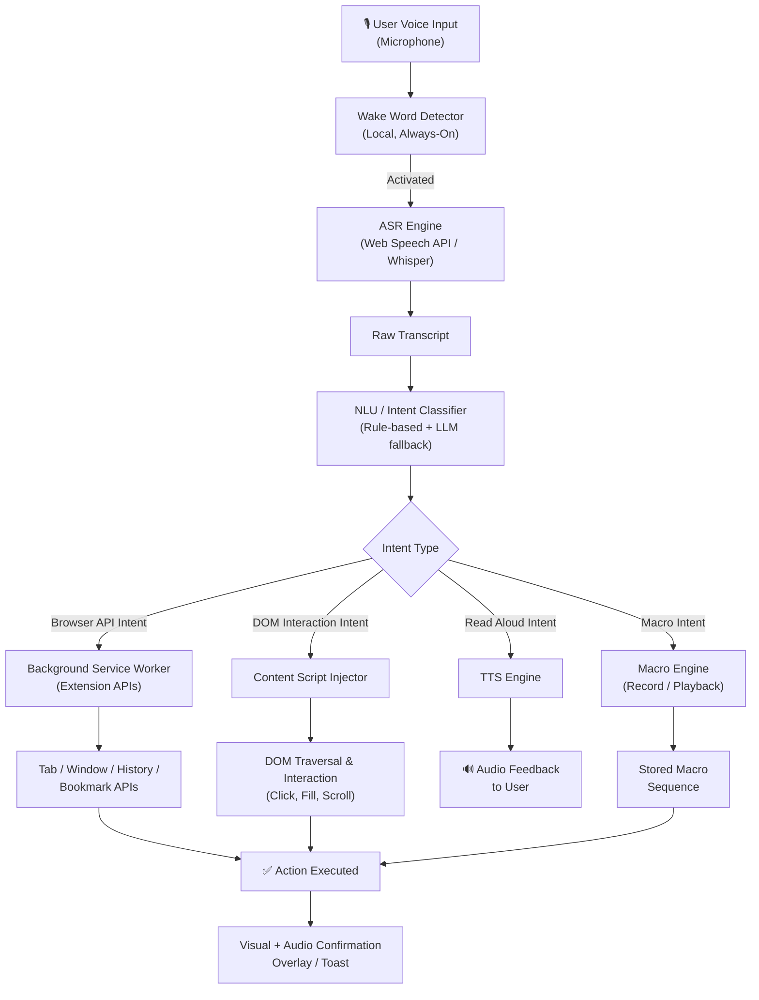
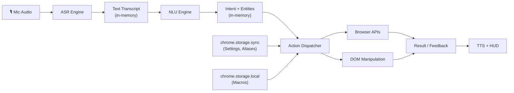

# Software Requirements Specification (SRS)
## VORDI — Voice-Operated Browser Control Extension

| Field | Value |
|---|---|
| **Document Version** | 1.0.0 |
| **Status** | Draft |
| **Date** | November 7, 2026 |
| **Author** | Software Architecture Team |
| **Classification** | Internal / Design |

---

## Table of Contents

1. [Introduction](#1-introduction)
2. [Overall Description](#2-overall-description)
3. [System Architecture Overview](#3-system-architecture-overview)
4. [Functional Requirements](#4-functional-requirements)
5. [Non-Functional Requirements](#5-non-functional-requirements)
6. [External Interface Requirements](#6-external-interface-requirements)
7. [System Constraints](#7-system-constraints)
8. [Use Cases](#8-use-cases)
9. [Data Requirements](#9-data-requirements)
10. [Security & Privacy Requirements](#10-security--privacy-requirements)
11. [Assumptions & Dependencies](#11-assumptions--dependencies)
12. [Glossary](#12-glossary)

---

## 1. Introduction

### 1.1 Purpose

This Software Requirements Specification (SRS) defines the functional and non-functional requirements for **VORDI** — a browser extension that enables complete hands-free, voice-driven control of a web browser. VORDI eliminates the need for manual clicking, typing, or keyboard interaction by translating natural language voice commands into precise browser actions.

### 1.2 Scope

VORDI is a cross-browser extension (targeting Chromium-based browsers and Firefox) that:

- Continuously (or on-demand) listens to the user's voice
- Processes voice input using speech recognition
- Interprets natural language intent using an NLP/LLM pipeline
- Executes corresponding browser actions (navigation, form filling, tab management, scrolling, clicking, etc.)
- Provides real-time audio/visual feedback

VORDI does **not** replace the browser's rendering engine or OS-level accessibility tools, but rather augments the browser with an intelligent voice command layer.

### 1.3 Definitions, Acronyms & Abbreviations

| Term | Definition |
|---|---|
| **VORDI** | Voice-Operated Remote-Directed Interface |
| **ASR** | Automatic Speech Recognition |
| **NLU** | Natural Language Understanding |
| **TTS** | Text-to-Speech |
| **DOM** | Document Object Model |
| **WER** | Word Error Rate (ASR accuracy metric) |
| **Wake Word** | Trigger phrase to activate listening (e.g., *"Hey VORDI"*) |
| **Intent** | The parsed action to be performed from voice input |
| **Entity** | Key information extracted from the command (URL, keyword, etc.) |
| **Content Script** | JavaScript injected by the extension into the active webpage |

### 1.4 References

- W3C Web Speech API Specification
- Chrome Extension Manifest V3 Documentation
- Firefox WebExtensions API
- WCAG 2.1 Accessibility Guidelines
- OWASP Browser Security Guidelines

### 1.5 Document Overview

Sections 2–3 describe the product context and high-level architecture. Sections 4–5 enumerate functional and non-functional requirements. Sections 6–10 cover interfaces, constraints, use cases, data, and security.

---

## 2. Overall Description

### 2.1 Product Perspective

VORDI integrates as a browser extension, sitting between the user's microphone input and the browser's internal APIs. It operates as a middleware layer:

```
[User Voice] → [ASR Engine] → [NLU/Intent Resolver] → [Action Dispatcher] → [Browser APIs / DOM]
```

It leverages:
- **Web Speech API** (or a local/cloud ASR fallback) for speech recognition
- **LLM/Rule-based NLU** for intent classification and entity extraction
- **Chrome Extension APIs** (tabs, windows, history, bookmarks, etc.) for browser control
- **Content Scripts** for webpage-level DOM interaction

### 2.2 Product Functions (Summary)

| Category | Capability |
|---|---|
| Navigation | Open URLs, go back/forward, reload, history search |
| Tab Management | Open, close, switch, duplicate, pin, group tabs |
| Page Interaction | Click elements, fill forms, scroll, select text, copy/paste |
| Search | Voice-trigger search on current page or new tab |
| Bookmarks | Add, remove, open bookmarks by name |
| Reading Mode | Read page content aloud via TTS |
| Settings Control | Zoom, dark mode toggle, extension management |
| Automation | Macro recording and playback of command sequences |
| Accessibility | Describe page elements, read alt text, ARIA labels |

### 2.3 User Classes and Characteristics

| User Class | Description | Priority |
|---|---|---|
| **Power Users** | Tech-savvy users wanting full hands-free browsing | High |
| **Accessibility Users** | Users with motor disabilities requiring voice-only interaction | High |
| **Multitaskers** | Users who browse while doing physical tasks | Medium |
| **Casual Users** | Occasional voice command use for convenience | Medium |
| **Developers** | Users leveraging VORDI's macro/scripting features | Low |

### 2.4 Operating Environment

- **Browsers:** Google Chrome (v110+), Microsoft Edge (v110+), Brave, Firefox (v115+)
- **OS:** Windows 10/11, macOS 12+, Ubuntu 20.04+
- **Hardware:** Microphone (built-in or external), minimum 4 GB RAM
- **Internet:** Required for cloud ASR/NLU mode; optional for local/offline mode
- **Permissions Required:** Microphone, tabs, activeTab, storage, bookmarks, history, scripting

### 2.5 Design and Implementation Constraints

- Must comply with Chrome Extension **Manifest V3** (MV3) architecture
- Background processing must use **Service Workers** (not persistent background pages)
- Microphone access requires explicit user consent per browser policy
- Cannot access browser UI chrome (address bar, settings pages) beyond permitted extension APIs
- Must not violate browser store policies (Chrome Web Store, Mozilla Add-ons)

### 2.6 Assumptions and Dependencies

- Users speak in a clear environment with minimal background noise
- Primary language support is English; multilingual support is a future phase
- Cloud ASR dependency on third-party (Google Speech-to-Text, OpenAI Whisper, or Web Speech API)
- LLM-based NLU may require an API key (OpenAI GPT / Gemini) for advanced intent parsing

---

## 3. System Architecture Overview



### 3.1 Core Components

| Component | Responsibility | Location |
|---|---|---|
| **Wake Word Engine** | Detect trigger phrase offline | Background Worker |
| **ASR Module** | Convert speech → text | Background Worker |
| **NLU Engine** | Extract intent + entities from text | Background Worker |
| **Action Dispatcher** | Route intents to correct handler | Background Worker |
| **Browser API Handler** | Execute tab/window/bookmark actions | Background Worker |
| **Content Script** | Interact with live webpage DOM | Injected per-page |
| **TTS Module** | Speak responses back to user | Background Worker |
| **Macro Engine** | Record, store, and replay sequences | Background Worker |
| **Settings & State Store** | Persist user preferences, macros | Chrome Storage API |
| **UI Overlay** | Show visual command feedback | Content Script / Popup |

---

## 4. Functional Requirements

> [!IMPORTANT]
> Requirements are tagged with priority: **[P1]** = Must Have, **[P2]** = Should Have, **[P3]** = Nice to Have.

---

### 4.1 Voice Activation & Listening

| ID | Requirement | Priority |
|---|---|---|
| FR-VA-01 | The system SHALL support a configurable wake word (default: *"Hey VORDI"*) to initiate listening | P1 |
| FR-VA-02 | The system SHALL support a push-to-talk mode via keyboard shortcut (configurable) | P1 |
| FR-VA-03 | The system SHALL support a continuous listening mode (always-on after activation) | P2 |
| FR-VA-04 | The system SHALL display a visual indicator (mic icon, color status) showing active listening state | P1 |
| FR-VA-05 | The system SHALL auto-timeout after 10 seconds of silence (configurable) | P1 |
| FR-VA-06 | The system SHALL allow the user to say "Stop listening" or "Cancel" to deactivate | P1 |
| FR-VA-07 | The system SHALL show a real-time transcript of recognized speech in a floating HUD | P2 |

---

### 4.2 Navigation Commands

| ID | Requirement | Priority |
|---|---|---|
| FR-NAV-01 | The system SHALL navigate to a URL when user says *"Go to [URL/website name]"* | P1 |
| FR-NAV-02 | The system SHALL navigate back when user says *"Go back"* | P1 |
| FR-NAV-03 | The system SHALL navigate forward when user says *"Go forward"* | P1 |
| FR-NAV-04 | The system SHALL reload the page on *"Reload"* or *"Refresh"* | P1 |
| FR-NAV-05 | The system SHALL open the browser homepage on *"Go home"* | P1 |
| FR-NAV-06 | The system SHALL navigate to common sites by nickname (e.g., *"Open YouTube"*) | P1 |
| FR-NAV-07 | The system SHALL stop page loading on *"Stop loading"* | P2 |

---

### 4.3 Tab Management

| ID | Requirement | Priority |
|---|---|---|
| FR-TAB-01 | The system SHALL open a new tab on *"Open new tab"* | P1 |
| FR-TAB-02 | The system SHALL close the current tab on *"Close tab"* | P1 |
| FR-TAB-03 | The system SHALL switch to a tab by ordinal *"Switch to tab 3"* or by partial title *"Switch to Gmail tab"* | P1 |
| FR-TAB-04 | The system SHALL duplicate the current tab on *"Duplicate tab"* | P2 |
| FR-TAB-05 | The system SHALL pin/unpin the current tab on *"Pin tab"* / *"Unpin tab"* | P2 |
| FR-TAB-06 | The system SHALL mute/unmute a tab on *"Mute tab"* / *"Unmute tab"* | P2 |
| FR-TAB-07 | The system SHALL list open tabs aloud on *"What tabs are open?"* | P2 |
| FR-TAB-08 | The system SHALL move a tab to a new window on *"Move tab to new window"* | P3 |
| FR-TAB-09 | The system SHALL group tabs on *"Group these tabs"* | P3 |

---

### 4.4 Page Interaction (DOM Control)

| ID | Requirement | Priority |
|---|---|---|
| FR-DOM-01 | The system SHALL click any interactive element identified by visible label text (e.g., *"Click Sign In"*) | P1 |
| FR-DOM-02 | The system SHALL fill input fields by label (e.g., *"Type hello world in the search box"*) | P1 |
| FR-DOM-03 | The system SHALL submit forms on *"Submit"* or *"Press Enter"* | P1 |
| FR-DOM-04 | The system SHALL scroll up/down by percentage or by landmark *"Scroll down half"*, *"Scroll to bottom"* | P1 |
| FR-DOM-05 | The system SHALL select/highlight text on *"Select all"* or *"Select from X to Y"* | P2 |
| FR-DOM-06 | The system SHALL copy selected text on *"Copy"* | P2 |
| FR-DOM-07 | The system SHALL paste clipboard content on *"Paste"* | P2 |
| FR-DOM-08 | The system SHALL hover over an element to trigger tooltips on *"Hover over [element]"* | P3 |
| FR-DOM-09 | The system SHALL right-click to show context menus on *"Right-click [element]"* | P3 |
| FR-DOM-10 | The system SHALL number all visible interactive elements on-screen on *"Show clickable elements"* (Element Picker Mode) | P2 |

---

### 4.5 Search

| ID | Requirement | Priority |
|---|---|---|
| FR-SRC-01 | The system SHALL perform a Google/default search engine search on *"Search for [query]"* | P1 |
| FR-SRC-02 | The system SHALL find text on the current page (Ctrl+F equivalent) on *"Find [term] on page"* | P1 |
| FR-SRC-03 | The system SHALL search within a specific site on *"Search YouTube for [query]"* | P2 |

---

### 4.6 Bookmarks & History

| ID | Requirement | Priority |
|---|---|---|
| FR-BKM-01 | The system SHALL add the current page to bookmarks on *"Bookmark this page"* | P1 |
| FR-BKM-02 | The system SHALL open a saved bookmark by name on *"Open bookmark [name]"* | P2 |
| FR-BKM-03 | The system SHALL delete a bookmark by name on *"Delete bookmark [name]"* | P3 |
| FR-HIS-01 | The system SHALL open the history page on *"Show history"* | P2 |
| FR-HIS-02 | The system SHALL navigate to recent history items on *"Go back to [site] from yesterday"* | P3 |

---

### 4.7 Reading Mode (TTS)

| ID | Requirement | Priority |
|---|---|---|
| FR-TTS-01 | The system SHALL read the main content of the current page aloud on *"Read this page"* | P2 |
| FR-TTS-02 | The system SHALL read selected text aloud on *"Read selection"* | P2 |
| FR-TTS-03 | The system SHALL pause/resume reading on *"Pause reading"* / *"Resume reading"* | P2 |
| FR-TTS-04 | The system SHALL stop reading on *"Stop reading"* | P2 |
| FR-TTS-05 | The system SHALL allow configurable voice, speed, and pitch for TTS | P3 |

---

### 4.8 Zoom & Display

| ID | Requirement | Priority |
|---|---|---|
| FR-DSP-01 | The system SHALL zoom in/out on *"Zoom in"* / *"Zoom out"* | P2 |
| FR-DSP-02 | The system SHALL reset zoom on *"Reset zoom"* | P2 |
| FR-DSP-03 | The system SHALL toggle full-screen on *"Full screen"* | P3 |

---

### 4.9 Macro & Automation Engine

| ID | Requirement | Priority |
|---|---|---|
| FR-MAC-01 | The system SHALL enter macro recording mode on *"Start recording macro"* | P2 |
| FR-MAC-02 | The system SHALL stop and save a macro on *"Stop recording macro"*, prompting for a name | P2 |
| FR-MAC-03 | The system SHALL play back a saved macro on *"Run macro [name]"* | P2 |
| FR-MAC-04 | The system SHALL list saved macros on *"List my macros"* | P3 |
| FR-MAC-05 | The system SHALL delete a macro on *"Delete macro [name]"* | P3 |

---

### 4.10 Accessibility Support

| ID | Requirement | Priority |
|---|---|---|
| FR-ACC-01 | The system SHALL describe the focused element aloud on *"What is this?"* | P2 |
| FR-ACC-02 | The system SHALL navigate by ARIA landmark regions on *"Go to main content"* | P2 |
| FR-ACC-03 | The system SHALL read image alt text on *"Describe image"* | P2 |

---

### 4.11 Settings & Configuration

| ID | Requirement | Priority |
|---|---|---|
| FR-SET-01 | The system SHALL provide a settings popup with toggle for wake word, language, ASR engine, TTS voice | P1 |
| FR-SET-02 | The system SHALL allow users to define custom voice command aliases | P2 |
| FR-SET-03 | The system SHALL allow enabling/disabling VORDI per site (allowlist/blocklist) | P2 |
| FR-SET-04 | The system SHALL support importing/exporting settings and macros as JSON | P3 |

---

## 5. Non-Functional Requirements

### 5.1 Performance

| ID | Requirement |
|---|---|
| NFR-PERF-01 | ASR transcription latency MUST be ≤ 1.5 seconds for commands under 10 words |
| NFR-PERF-02 | Intent classification MUST complete within 300ms for rule-based intents |
| NFR-PERF-03 | DOM interaction (click, fill, scroll) MUST execute within 500ms of intent resolution |
| NFR-PERF-04 | Extension idle CPU usage MUST NOT exceed 2% |
| NFR-PERF-05 | Extension memory footprint MUST NOT exceed 50 MB |

### 5.2 Reliability

| ID | Requirement |
|---|---|
| NFR-REL-01 | The system MUST gracefully handle ASR failures with a "Didn't catch that" fallback |
| NFR-REL-02 | The system MUST handle page load errors and unresponsive content scripts without crashing |
| NFR-REL-03 | The system MUST recover from Service Worker suspension automatically |
| NFR-REL-04 | ASR accuracy (WER) MUST be < 10% in a standard office noise environment |

### 5.3 Usability

| ID | Requirement |
|---|---|
| NFR-USE-01 | The system MUST provide voice AND visual confirmation for every executed action |
| NFR-USE-02 | First-time setup MUST be completable within 2 minutes including permission grants |
| NFR-USE-03 | The system MUST offer an interactive onboarding tutorial with sample voice commands |
| NFR-USE-04 | Error messages MUST be human-friendly and suggest corrective commands |

### 5.4 Security

| ID | Requirement |
|---|---|
| NFR-SEC-01 | Microphone access MUST only be active while VORDI is in listening mode |
| NFR-SEC-02 | No audio data MUST be stored locally or transmitted without user consent |
| NFR-SEC-03 | API keys for cloud NLU/ASR services MUST be stored in encrypted browser storage |
| NFR-SEC-04 | The extension MUST NOT inject scripts on banking or sensitive domains unless allowlisted by user |
| NFR-SEC-05 | The system MUST comply with Manifest V3's Content Security Policy |

### 5.5 Privacy

| ID | Requirement |
|---|---|
| NFR-PRV-01 | The system MUST offer a fully offline mode (local ASR + rule-based NLU) with no data leaving the device |
| NFR-PRV-02 | Cloud mode MUST display a clear disclosure of which data is sent and to what service |
| NFR-PRV-03 | Voice transcripts MUST NOT be persisted beyond the duration of a single command session unless explicitly enabled |

### 5.6 Compatibility

| ID | Requirement |
|---|---|
| NFR-CMP-01 | The extension MUST function on Chrome 110+, Edge 110+, and Firefox 115+ |
| NFR-CMP-02 | The extension MUST support Windows 10+, macOS 12+, and Ubuntu 20.04+ |
| NFR-CMP-03 | The extension MUST be compatible with pages using React, Angular, Vue, and plain HTML |

### 5.7 Maintainability

| ID | Requirement |
|---|---|
| NFR-MNT-01 | The codebase MUST follow modular architecture with separation between ASR, NLU, and Action layers |
| NFR-MNT-02 | The intent registry MUST be data-driven (JSON/YAML) to allow addition of new commands without code changes |
| NFR-MNT-03 | The system MUST include automated unit tests for the NLU and Action Dispatcher layers |

---

## 6. External Interface Requirements

### 6.1 User Interfaces

| Interface | Description |
|---|---|
| **Popup Panel** | Main settings, enable/disable toggle, mic level indicator, macro list |
| **Floating HUD** | Transparent overlay showing real-time transcript and last executed command |
| **Element Picker Overlay** | Numbered labels on all clickable elements during "Show clickable elements" mode |
| **Onboarding Wizard** | Step-by-step first-run tour in a new tab |
| **Command Cheatsheet** | Quick-reference popup listing all voice commands |

### 6.2 Hardware Interfaces

- **Microphone:** Standard Web Audio API access via `getUserMedia()`; supports all browser-compatible mic devices
- **Speakers/Headphones:** Standard Web Audio API for TTS playback

### 6.3 Software / API Interfaces

| External System | Purpose | Mode |
|---|---|---|
| **Web Speech API** | Built-in browser ASR | Online (Chrome) |
| **OpenAI Whisper API** | High-accuracy cloud ASR | Online (optional) |
| **Google Speech-to-Text** | Alternative cloud ASR | Online (optional) |
| **whisper.cpp / Vosk** | Local offline ASR engine | Offline |
| **OpenAI GPT / Gemini API** | LLM-based NLU for complex commands | Online (optional) |
| **Chrome Extension APIs** | tabs, windows, history, bookmarks, scripting | Local |
| **Web Speech SpeechSynthesis** | TTS for audio feedback | Local |

### 6.4 Communication Interfaces

- Extension popup ↔ Background Service Worker: `chrome.runtime.sendMessage` / `chrome.runtime.onMessage`
- Background Worker ↔ Content Script: `chrome.tabs.sendMessage`
- Cloud ASR/NLU: HTTPS REST APIs with JSON payloads, TLS 1.2+

---

## 7. System Constraints

> [!WARNING]
> The following constraints are imposed by browser architecture and cannot be engineered around.

| Constraint | Detail |
|---|---|
| **MV3 Service Workers** | Background scripts cannot maintain persistent state; must use `chrome.storage` for all state |
| **Address Bar Access** | Extensions cannot directly read or write the browser's URL bar; must use `chrome.tabs.update()` |
| **Browser UI Chrome** | Buttons like Back/Forward in the browser toolbar cannot be directly clicked by extension APIs |
| **Cross-Origin Isolation** | Content scripts cannot access cross-origin iframes |
| **CSP Restrictions** | Pages with strict CSP may block injected scripts; VORDI must handle these gracefully |
| **Microphone Scope** | Web Speech API may require the extension popup to remain open in some browsers |

---

## 8. Use Cases

### UC-01: Navigate to a Website by Voice

| Field | Detail |
|---|---|
| **Actor** | User |
| **Trigger** | User says *"Hey VORDI, go to github.com"* |
| **Precondition** | VORDI is enabled, mic is active |
| **Main Flow** | 1. Wake word detected → ASR activated → "go to github.com" transcribed → Intent: NAVIGATE, Entity: `github.com` → `chrome.tabs.update({url: "https://github.com"})` → HUD shows "Navigating to github.com" |
| **Alternate Flow** | If URL is ambiguous → VORDI asks *"Did you mean github.com?"* |
| **Postcondition** | Active tab loads the specified URL |

---

### UC-02: Click a Button by Voice

| Field | Detail |
|---|---|
| **Actor** | User |
| **Trigger** | User says *"Click the Sign In button"* |
| **Precondition** | Current page has a button with visible text "Sign In" |
| **Main Flow** | 1. Intent: CLICK, Entity: "Sign In" → Content script searches DOM for element matching text → Element found → `element.click()` dispatched → HUD confirms "Clicked Sign In" |
| **Alternate Flow A** | Multiple matches → VORDI overlays numbered labels → *"Which one? Say 1, 2, or 3"* |
| **Alternate Flow B** | No match → VORDI says *"Couldn't find a button called Sign In. Try 'Show clickable elements'"* |

---

### UC-03: Fill and Submit a Form

| Field | Detail |
|---|---|
| **Actor** | User |
| **Trigger** | *"Type john@example.com in the email field"* then *"Submit the form"* |
| **Main Flow** | 1. Intent: FILL, Entity: `{field: "email", value: "john@example.com"}` → Content script finds input[type=email] or label matching "email" → Sets `.value`, dispatches `input` event → User says "Submit" → Content script finds and submits the form |

---

### UC-04: Run a Saved Macro

| Field | Detail |
|---|---|
| **Actor** | User |
| **Trigger** | *"Run macro morning routine"* |
| **Main Flow** | Macro Engine loads stored action sequence → Executes actions in order: open gmail.com, switch to tab 2, scroll down → Confirms *"Macro morning routine completed"* |

---

## 9. Data Requirements

### 9.1 Stored Data

| Data Item | Storage Location | Retention |
|---|---|---|
| User preferences (language, wake word, ASR engine) | `chrome.storage.sync` | Persistent |
| Saved macros | `chrome.storage.local` | Persistent |
| Custom command aliases | `chrome.storage.sync` | Persistent |
| Session transcript (HUD display) | In-memory only | Session only |
| Allowlist/blocklist of domains | `chrome.storage.sync` | Persistent |

### 9.2 Data Flow Diagram



---

## 10. Security & Privacy Requirements

> [!CAUTION]
> Microphone access is a high-sensitivity permission. VORDI's security model must be explicit and auditable.

### 10.1 Threat Model

| Threat | Mitigation |
|---|---|
| **Unauthorized mic recording** | Mic active only during command sessions; visual indicator always shown |
| **Command injection via page content** | NLU must distinguish between user speech and page-rendered text |
| **API key theft** | Keys stored in `chrome.storage.local` (encrypted); never in source code |
| **Malicious page triggering DOM actions** | Content scripts only execute actions originating from the background worker |
| **Data exfiltration via cloud ASR** | Offline mode available; cloud mode shows clear disclosure |

### 10.2 Permission Justification

| Permission | Justification |
|---|---|
| `microphone` | Core functionality: speech capture |
| `tabs` | Tab management commands |
| `activeTab` | DOM interaction on current page |
| `storage` | Persist settings, macros, preferences |
| `bookmarks` | Bookmark management commands |
| `history` | History navigation commands |
| `scripting` | Inject content scripts for DOM interaction |
| `tts` | Text-to-speech feedback |

---

## 11. Assumptions & Dependencies

### 11.1 Assumptions

1. The user has a functional microphone connected to their device
2. English is the primary target language for Phase 1
3. Users will grant required permissions during onboarding
4. Network connectivity is available for cloud ASR/NLU mode
5. Web pages follow standard HTML semantics (accessible labels, roles)

### 11.2 Dependencies

| Dependency | Type | Risk if Unavailable |
|---|---|---|
| Web Speech API | Browser built-in | High — fallback to Whisper required |
| Chrome Extension APIs | Browser platform | Critical — extension cannot function |
| OpenAI / Gemini API | External (optional) | Low — rule-based NLU used as fallback |
| whisper.cpp (local) | Optional library | Medium — offline mode unavailable |
| SpeechSynthesis API | Browser built-in | Low — TTS features disabled gracefully |

---

## 12. Glossary

| Term | Definition |
|---|---|
| **Action Dispatcher** | The module that maps resolved intents to concrete browser or DOM actions |
| **Content Script** | JavaScript file injected by the extension into web pages to manipulate the DOM |
| **DOM Traversal** | The process of searching the page's HTML tree to identify elements by label, role, or position |
| **Element Picker Mode** | A visual mode where VORDI overlays numbered badges on all interactive elements |
| **Intent** | The parsed meaning and goal of a voice command (e.g., NAVIGATE, CLICK, FILL) |
| **Macro** | A recorded sequence of voice commands that can be replayed in one trigger |
| **Manifest V3 (MV3)** | The current Chrome extension platform requiring Service Workers instead of background pages |
| **NLU** | Natural Language Understanding — the AI layer that interprets intent and extracts entities from text |
| **Service Worker** | The background script in MV3 extensions; event-driven, not persistent |
| **Wake Word** | A short phrase (e.g., *"Hey VORDI"*) that activates the listening mode |
| **WER** | Word Error Rate — the percentage of words incorrectly transcribed by ASR |

---

> [!NOTE]
> **Next Steps after SRS approval:**
> - Phase 2: System Design Document (SDD) — detailed component diagrams, API contracts, state machines
> - Phase 3: UI/UX Wireframes — popup, HUD overlay, onboarding wizard
> - Phase 4: Technical Proof of Concept — ASR + NLU pipeline spike
> - Phase 5: Implementation Sprints — modular build starting with Navigation & Tab Management
