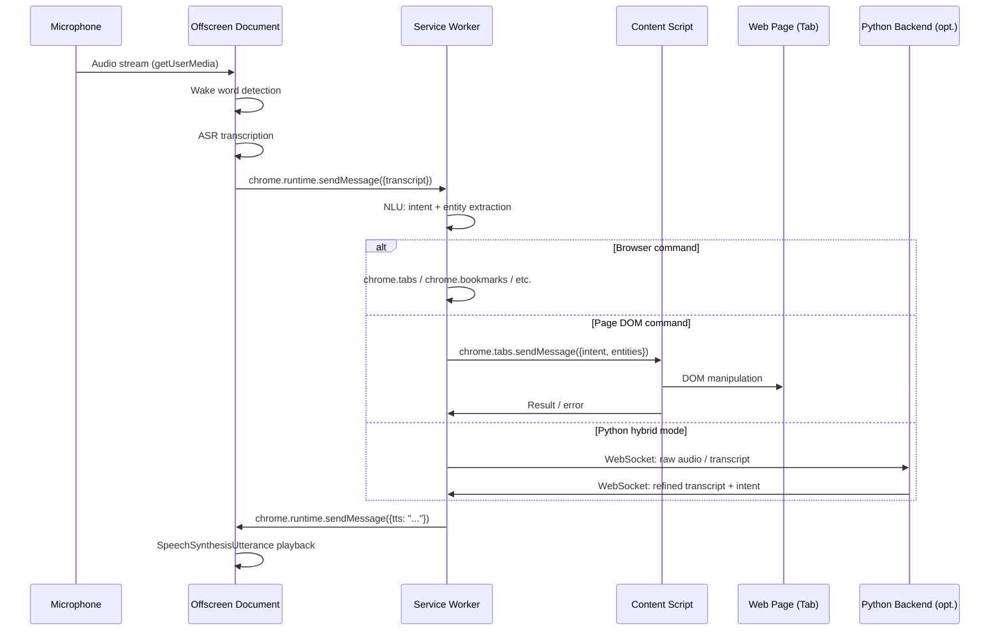
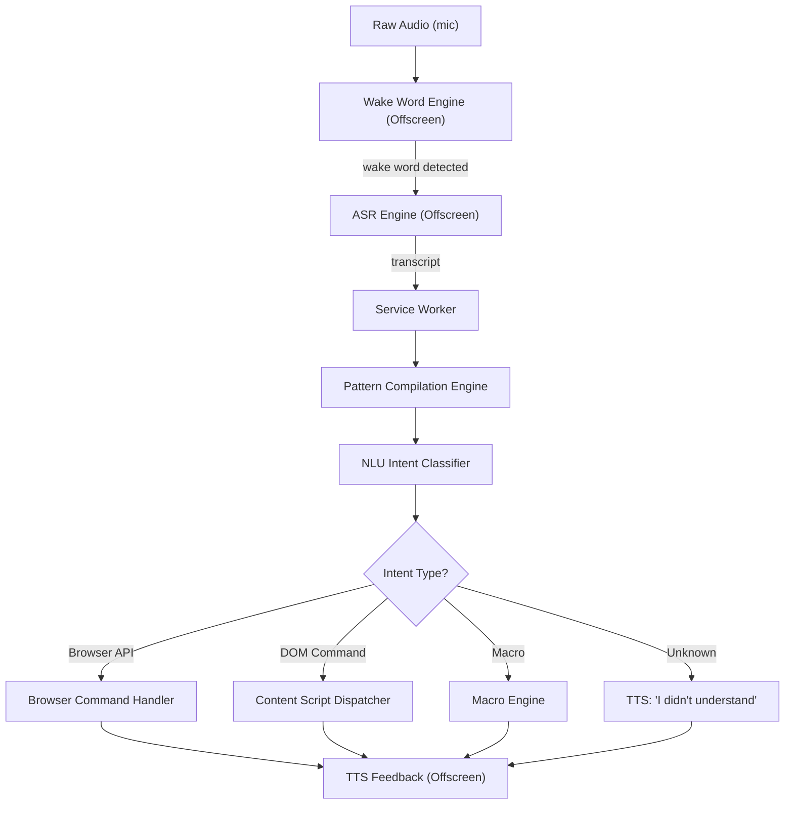

# Software Requirements Specification (SRS)
## VORDI — Voice-Operated Browser Control Extension
### Version 1.1 | Status: Draft | Classification: Internal

---

| Field | Value |
|---|---|
| Document ID | VORDI-SRS-001 |
| Version | 1.1 |
| Status | Draft |
| Date | 2026-11-07 |
| Authors | VORDI Engineering Team |
| Reviewers | Architecture Review Board |
| Supersedes | VORDI-SRS-001 v1.0 |

---

## Change Log (v1.0 → v1.1)

> [!IMPORTANT]
> All 24 corrections from the VORDI SRS Audit Report have been applied in this revision. Changed requirements are marked with `[v1.1]` in their ID columns throughout the document.

| Fix ID | Severity | Section(s) Affected | Summary |
|---|---|---|---|
| CRIT-01 | Critical | §2.1, §6.2 | ASR/Wake Word/TTS run in Offscreen Document, not Service Worker; added `offscreen` permission |
| CRIT-02 | Critical | §2.5, §4.3 | MV3 SW suspension caveat; Alarms-based keepalive heartbeat; updated FR-VA-03 |
| CRIT-03 | Critical | §2.5, §6.2 | Python backend requires Native Messaging Host; `nativeMessaging` added as optional permission |
| CRIT-04 | Critical | §4.4 | Removed impossible FR-DOM-09 (right-click context menu); replaced with custom overlay panel |
| HIGH-01 | High | §2.1, §3.1 | TTS Module location updated from "Background Worker" to "Offscreen Document" |
| HIGH-02 | High | §7 | Clipboard API user-gesture constraint; FR-DOM-07 uses execCommand fallback |
| HIGH-03 | High | §4.9 | FR-MAC-06: macro engine waits for `tabs.onUpdated status=complete` before DOM steps |
| HIGH-04 | High | §4.4 | FR-DOM-02 note: form filling uses native input value setter for React/Vue/Angular |
| HIGH-05 | High | §7 | `chrome.storage.session` Firefox ≤115 fallback Map in Service Worker |
| HIGH-06 | High | §7 | Content scripts blocked on chrome://, chrome-extension://, about:, PDF; graceful error |
| MED-01 | Medium | §2.1 | Intent pattern registry uses {placeholder} tokens → named-capture-group regex |
| MED-02 | Medium | §4.4 | INTERACTIVE_SELECTOR definition enumerated explicitly |
| MED-03 | Medium | §4.3 | FR-VA-02 updated: keyboard shortcut predefined set + chrome.commands.update() |
| MED-04 | Medium | §7 | Cross-origin iframe DOM access limitation + TTS error; all_frames:true for same-origin |
| MED-05 | Medium | §5.1 | NFR-PERF-01 latency budget refined: ≤2.0s (10 words), ≤1.5s (< 5 words) |
| MED-06 | Medium | §4.12 (new) | New section: Undo & Safety (FR-UND-01, FR-UND-02, FR-UND-03) |
| MED-07 | Medium | §4.7 | FR-TTS-06: echo cancellation + mic mute during TTS output |
| SEC-01 | Security | §10 | Python backend session token validation; bind to 127.0.0.1 only |
| SEC-02 | Security | §10 | Echo cancellation for audio injection mitigation; unrecognized URL voice confirmation |
| MISS-01 | Missing | §3.1, §6.2 | Offscreen Document added to Core Components and Permissions tables |

---

## Table of Contents

1. [Introduction](#1-introduction)
2. [Overall Description](#2-overall-description)
3. [System Architecture Overview](#3-system-architecture-overview)
4. [Functional Requirements](#4-functional-requirements)
5. [Non-Functional Requirements](#5-non-functional-requirements)
6. [External Interface Requirements](#6-external-interface-requirements)
7. [System Constraints](#7-system-constraints)
8. [Data Requirements](#8-data-requirements)
9. [Error Handling & Recovery](#9-error-handling--recovery)
10. [Security Requirements](#10-security-requirements)
11. [Accessibility & Internationalization](#11-accessibility--internationalization)
12. [Appendices](#12-appendices)

---

## 1. Introduction

### 1.1 Purpose

This Software Requirements Specification (SRS) defines the complete functional and non-functional requirements for the **VORDI** browser extension — a voice-operated browser control system that enables users to navigate, interact with, and manage their web browser entirely through spoken natural language commands, without any clicking or keyboard input.

This document is intended for:
- Software engineers implementing VORDI
- QA engineers writing test plans
- Product managers tracking scope and acceptance criteria
- Security reviewers performing threat modelling

### 1.2 Scope

VORDI is a cross-browser extension (targeting Chromium MV3 and Firefox MV3-compatible APIs) that:

- Listens for a configurable wake word ("Hey VORDI") to activate
- Transcribes user speech using an Automatic Speech Recognition (ASR) engine
- Parses transcribed text into structured intents using a Natural Language Understanding (NLU) pipeline
- Executes browser-level commands (navigation, tab management, bookmarks) via WebExtension APIs
- Executes page-level commands (clicking, scrolling, form filling, text selection) via content scripts injected into web pages
- Provides audio feedback via Text-to-Speech (TTS) synthesis
- Supports macro recording, playback, and scheduling for multi-step command automation
- Optionally delegates ASR/NLU processing to a local Python backend over WebSocket for higher accuracy

**Out of Scope:**
- Cloud-based voice processing or telemetry to external servers
- Voice-based video/audio calling features
- Mobile browser support (Android Chrome / iOS Safari)
- Browser UI chrome customization (toolbar, address bar rendering)

### 1.3 Definitions, Acronyms, and Abbreviations

| Term | Definition |
|---|---|
| ASR | Automatic Speech Recognition — converts audio to text |
| NLU | Natural Language Understanding — maps text to structured intent + entities |
| TTS | Text-to-Speech — converts text to synthesized audio output |
| MV3 | Manifest Version 3 — the current Chrome/Firefox WebExtension manifest format |
| SW | Service Worker — the MV3 background script context |
| DOM | Document Object Model — the structured representation of a web page |
| Intent | A classified action type extracted from NLU (e.g., NAVIGATE, CLICK, SCROLL) |
| Entity | A named slot value within an intent (e.g., URL, element label, direction) |
| Wake Word | A trigger phrase ("Hey VORDI") that activates the listening pipeline |
| Macro | A named, replayable sequence of voice commands |
| Offscreen Document | A hidden HTML page (MV3 `offscreen` API) used to run Web Audio and MediaStream APIs that are unavailable in Service Workers |
| NFR | Non-Functional Requirement |
| FR | Functional Requirement |
| NMH | Native Messaging Host — a registered OS-level process that an extension can communicate with via stdio |
| PCE | Pattern Compilation Engine — compiles {placeholder} intent patterns to named-capture-group regexes |

### 1.4 References

- [Chrome Extensions MV3 Documentation](https://developer.chrome.com/docs/extensions/mv3/)
- [Chrome Offscreen Document API](https://developer.chrome.com/docs/extensions/reference/offscreen/)
- [Web Speech API Specification (W3C)](https://wicg.github.io/speech-api/)
- [WebExtensions API (MDN)](https://developer.mozilla.org/en-US/docs/Mozilla/Add-ons/WebExtensions)
- [Chrome Native Messaging](https://developer.chrome.com/docs/extensions/mv3/nativeMessaging/)
- [VORDI Architecture Decision Records (internal)]
- [VORDI Threat Model v0.9 (internal)]

### 1.5 Document Conventions

- Requirements are identified by structured IDs: `FR-<DOMAIN>-NN` (functional) or `NFR-<CATEGORY>-NN` (non-functional)
- Priority levels: **[P1]** = Must Have, **[P2]** = Should Have, **[P3]** = Nice to Have
- **[v1.1]** tag in the ID column indicates a requirement added or modified in this revision

---

## 2. Overall Description

### 2.1 Product Perspective

VORDI operates as a browser extension, running within the browser's extension sandbox. It integrates the following processing pipeline:

```
Microphone Audio
      │
      ▼
[Offscreen Document]  ← Wake Word Detection (Porcupine / custom WASM)
      │                 ASR (Web Speech API or Whisper.cpp WASM)
      │                 TTS (SpeechSynthesisUtterance or backend relay)
      │
      ▼ (message via chrome.runtime)
[Service Worker]  ← Intent Routing, Browser API Commands, Macro Engine
      │
      ├──▶ [Content Script]  ← DOM interaction (click, scroll, fill, select)
      │
      └──▶ [Python Backend]  ← (Optional) High-accuracy ASR/NLU over WebSocket
                                Launched via Native Messaging Host (NMH)
```

> [!IMPORTANT] **[v1.1] CRIT-01 / MISS-01:** ASR, Wake Word Detection, and TTS synthesis run exclusively inside an **Offscreen Document** (`offscreen.html`), not in the Service Worker. This is required because MV3 Service Workers lack access to `MediaStream`, `AudioContext`, `getUserMedia`, and `SpeechSynthesis` APIs. The Offscreen Document is created on demand via `chrome.offscreen.createDocument()` and communicates with the Service Worker via `chrome.runtime.sendMessage`.

> [!NOTE] **[v1.1] MED-01:** The intent pattern registry uses `{placeholder}` tokens (e.g., `"open {url}"`, `"scroll {direction} {amount}"`) that are compiled to **named-capture-group regular expressions** by the **Pattern Compilation Engine (PCE)** at initialization time. For example, `"go to {url}"` compiles to `/^go to (?<url>.+)$/i`.

The extension does not require any internet connectivity. All processing is performed locally in the browser or in an optional local Python process. No user audio or browsing data is transmitted externally.

### 2.2 Product Functions

At a high level, VORDI provides the following major capabilities:

1. **Voice Activation** — Wake word detection and push-to-talk modes
2. **Speech Recognition** — Local or hybrid ASR pipeline
3. **Intent Recognition** — NLU mapping of transcribed text to actionable intents
4. **Browser Control** — Tab management, navigation, bookmarks, history, downloads
5. **DOM Interaction** — Click, scroll, fill, select, copy, navigate page elements
6. **Text Operations** — Find, copy, select text on page
7. **TTS Feedback** — Spoken confirmation and error feedback
8. **Macro System** — Recording, playback, naming, and scheduling of command sequences
9. **Settings & Configuration** — Extension options page for all configurable parameters
10. **Undo & Safety** — Action reversal and destructive action confirmation
11. **Accessibility** — High-contrast UI, screen-reader compatibility, reduced-motion support

### 2.3 User Classes and Characteristics

| User Class | Description | Technical Level | Primary Need |
|---|---|---|---|
| Accessibility User | Users with motor impairments who cannot use mouse/keyboard | Low–Medium | Hands-free full browser control |
| Power User | Users who want faster browser control via voice | High | Macro automation, speed |
| Casual User | General users exploring voice interaction | Low | Simple navigation & tab management |
| Developer/Tester | Extension developers and QA engineers | High | Debugging, macro authoring |

### 2.4 Operating Environment

| Dimension | Specification |
|---|---|
| Primary Browser | Google Chrome 109+ (MV3) |
| Secondary Browser | Microsoft Edge 109+ (Chromium-based, MV3) |
| Tertiary Browser | Firefox 115+ (MV3-compatible, with noted API differences — see §7) |
| OS | Windows 10/11, macOS 12+, Ubuntu 20.04+ |
| Microphone | Any OS-recognized input device; `getUserMedia` permission required |
| Optional Backend | Python 3.9+, exposed on `ws://127.0.0.1:<port>` via Native Messaging Host |

### 2.5 Design Constraints

> [!WARNING] **[v1.1] CRIT-02:** MV3 Service Workers are **not persistent** and may be suspended by the browser after approximately 30 seconds of inactivity. A Chrome Alarms-based keepalive heartbeat (firing every **24 seconds** via `chrome.alarms.create`) is required to prevent SW suspension and to maintain the wake word pipeline that runs in the Offscreen Document. The Offscreen Document itself must be re-created if it is closed unexpectedly.

> [!WARNING] **[v1.1] CRIT-03:** In the Python-hybrid architecture, the Python backend process **cannot be launched directly by the extension**. It must be launched via a registered **Chrome Native Messaging Host (NMH)** (using the `nativeMessaging` permission) or via a companion OS-level installer/launcher. The extension communicates with the NMH over stdio-based Native Messaging protocol.

- **MV3 API surface**: The extension must only use APIs available in Manifest Version 3. Persistent background pages are prohibited.
- **No remote code execution**: No remotely hosted scripts may be executed. All logic must be bundled in the extension package or in the local Python backend.
- **Microphone access**: The extension requires explicit user permission for `getUserMedia({ audio: true })`. The permission prompt is initiated from the Offscreen Document.
- **Content Security Policy**: Extension pages enforce strict CSP (`script-src 'self'`). No inline scripts or eval() usage.
- **Offscreen Document lifecycle**: Only one Offscreen Document may exist at a time (Chrome limitation). The Service Worker must check for an existing document before creating one.
- **Storage quotas**: `chrome.storage.local` has a default quota of 10 MB. Macro storage must respect this limit.

---

## 3. System Architecture Overview

### 3.1 Core Components

| Component | Type | Location | Responsibility |
|---|---|---|---|
| Background Service Worker | Service Worker | `background.js` | Intent routing, browser API execution, macro engine, keepalive heartbeat |
| **[v1.1] Offscreen Document** | Offscreen Document | `offscreen.html` (MV3 Offscreen Document) | Wake word detection, ASR, TTS synthesis, microphone access |
| Content Script | Injected Script | `content.js` (injected into page) | DOM interaction, element selection, page-level commands |
| Popup UI | Extension Popup | `popup.html` | Status display, quick settings, visual feedback |
| Options Page | Extension Page | `options.html` | Full settings management |
| NLU Engine | JS Module | Loaded in Service Worker | Intent + entity extraction from transcribed text |
| Pattern Compilation Engine | JS Module | Loaded in Service Worker | Compiles {placeholder} patterns to named-capture-group regex at init |
| Macro Engine | JS Module | Loaded in Service Worker | Macro recording, playback, scheduling, undo stack |
| Python Backend (optional) | External Process | `ws://127.0.0.1:<port>` | High-accuracy Whisper ASR + advanced NLU; launched via NMH |

### 3.2 Communication Flow



### 3.3 Data Flow Summary



---

## 4. Functional Requirements

### 4.1 Requirement Notation

Each requirement follows this format:

> `FR-<DOMAIN>-NN [Pn] [v1.1 if changed]: The system SHALL/SHOULD/MAY...`

Domains: **VA** (Voice Activation), **ASR** (Speech Recognition), **NLU** (Understanding), **DOM** (DOM Interaction), **NAV** (Navigation), **TAB** (Tab Management), **BKM** (Bookmarks), **TTS** (Text-to-Speech), **MAC** (Macro), **SET** (Settings), **UND** (Undo).

---

### 4.2 Voice Activation (VA)

**FR-VA-01 [P1]:** The system SHALL detect the wake phrase "Hey VORDI" (or user-configured alternative) from continuous microphone audio and transition to active listening state without requiring any manual interaction.

**FR-VA-02 [P1] [v1.1 MED-03]:** The system SHALL support a **push-to-talk mode** activated via a keyboard shortcut selected from a predefined set of allowed combinations declared in `manifest.json` commands and optionally updated at runtime via `chrome.commands.update()` on Chrome 109+. The predefined allowed set SHALL be documented in the Options page.

**FR-VA-03 [P1] [v1.1 CRIT-02]:** The system SHALL support **continuous listening mode sustained via Offscreen Document and Service Worker keepalive heartbeat** (Chrome Alarms firing every 24 seconds), so that the wake word pipeline remains active without requiring user action to restart it.

**FR-VA-04 [P2]:** The system SHALL provide a visual indicator (popup badge or floating indicator) showing current listening state: `IDLE`, `LISTENING`, `PROCESSING`, `SPEAKING`.

**FR-VA-05 [P1]:** The system SHALL allow the user to disable voice activation entirely from the Options page or via a keyboard shortcut, stopping all microphone access.

**FR-VA-06 [P2]:** The system SHALL automatically pause the wake word engine when the microphone permission is revoked by the user and emit a TTS notification: "VORDI has lost microphone access. Please re-enable it in browser settings."

**FR-VA-07 [P3]:** The system SHOULD support user-configurable sensitivity (threshold) for wake word detection to reduce false positives.

---

### 4.3 Speech Recognition (ASR)

**FR-ASR-01 [P1]:** The system SHALL transcribe user speech to text using the **Web Speech API** (`webkitSpeechRecognition`) running inside the **Offscreen Document** as the default ASR engine.

**FR-ASR-02 [P2]:** The system SHALL support an optional **Whisper.cpp WASM** in-browser model as a higher-accuracy ASR alternative, configurable from the Options page.

**FR-ASR-03 [P2]:** The system SHALL support routing audio to the **Python backend** (over WebSocket) for ASR when the Python hybrid mode is enabled.

**FR-ASR-04 [P1]:** The system SHALL display a real-time partial transcript in the popup UI while ASR is in progress.

**FR-ASR-05 [P2]:** The system SHALL support a user-configurable ASR language/locale (default: `en-US`).

**FR-ASR-06 [P1]:** The system SHALL timeout and return to `IDLE` state if no speech is detected within 8 seconds of activation (configurable, range: 3–30 s).

**FR-ASR-07 [P2]:** The system SHALL support custom vocabulary hints (user-defined words/names) passed to the ASR engine to improve recognition of proper nouns and domain-specific terms.

---

### 4.4 DOM Interaction (DOM)

> [!NOTE] **[v1.1] MED-02:** The `INTERACTIVE_SELECTOR` used by all click/focus/hover commands is defined as:
> ```
> a[href], button, input, select, textarea,
> [role=button], [role=link], [role=menuitem], [role=tab],
> [role=checkbox], [role=radio],
> [tabindex]:not([tabindex="-1"]),
> summary, label[for]
> ```

**FR-DOM-01 [P1]:** The system SHALL click the first element on the page matching a spoken label, using `INTERACTIVE_SELECTOR` and fuzzy text matching (Levenshtein distance ≤ 2 or token overlap ≥ 80%).

**FR-DOM-02 [P1]:** The system SHALL fill form inputs with spoken text via the command "Type [text] in [field label]" or "Fill [field label] with [text]".

> [!NOTE] **[v1.1] HIGH-04:** Form filling SHALL use the **native input value setter** obtained via `Object.getOwnPropertyDescriptor(HTMLInputElement.prototype, 'value').set` to dispatch a synthetic React/Vue/Angular-compatible `input` event. This ensures compatibility with reactive form frameworks that intercept value assignment. After setting the value, the system SHALL dispatch both `input` and `change` events on the target element.

**FR-DOM-03 [P1]:** The system SHALL scroll the page in the spoken direction: "Scroll up/down/left/right [amount]", where amount defaults to one viewport height if unspecified.

**FR-DOM-04 [P1]:** The system SHALL scroll to the top or bottom of the page on commands "Go to top" / "Go to bottom".

**FR-DOM-05 [P2]:** The system SHALL select all text in a specified element on command "Select text in [element label]" using `element.select()` or a `Selection` range.

**FR-DOM-06 [P2]:** The system SHALL copy selected text or the text content of a named element to the clipboard via "Copy [element label]" using `navigator.clipboard.writeText()`.

**FR-DOM-07 [P2] [v1.1 HIGH-02]:** The system SHALL attempt to paste clipboard content into focused inputs via voice command "Paste". The implementation SHALL first attempt `navigator.clipboard.readText()` (requires `clipboardRead` permission and an active user gesture); if unavailable, SHALL fall back to `document.execCommand('paste')`. If both fail, the system SHALL relay clipboard content via `chrome.storage.session` (written from a privileged extension context).

**FR-DOM-08 [P2]:** The system SHALL find and highlight the first occurrence of spoken text via "Find [text]", visually highlighting the match and optionally reading surrounding context via TTS.

**FR-DOM-09 [P3] [v1.1 CRIT-04]:** The system SHALL display a **VORDI custom action panel** (a custom overlay UI injected by the content script, containing options such as "Copy Link", "Open in New Tab", "Save to Bookmarks", "Copy Text") when the user says "Show options for [element]". The panel SHALL be keyboard-navigable and closeable via "Close panel" or Escape.

**FR-DOM-10 [P2]:** The system SHALL hover over a named element ("Hover over [element]"), triggering `mouseenter` and `mouseover` events to reveal tooltips or dropdown menus.

**FR-DOM-11 [P3]:** The system SHALL support "Focus [element label]" to programmatically focus form inputs or interactive elements, calling `element.focus({ preventScroll: false })`.

---

### 4.5 Browser Navigation (NAV)

**FR-NAV-01 [P1]:** The system SHALL navigate the current tab to a spoken URL or search query via "Go to [URL/query]", "Navigate to [URL]", or "Open [URL]".

**FR-NAV-02 [P1]:** The system SHALL navigate back and forward in browser history via "Go back" and "Go forward", using `chrome.tabs.goBack()` and `chrome.tabs.goForward()`.

**FR-NAV-03 [P1]:** The system SHALL reload the current page via "Reload" or "Refresh page".

**FR-NAV-04 [P1]:** The system SHALL hard-reload (bypass cache) via "Hard reload" or "Reload without cache", using `chrome.tabs.reload({ bypassCache: true })`.

**FR-NAV-05 [P2]:** The system SHALL open a new tab (blank or at a specified URL) via "Open new tab" or "New tab [URL]".

**FR-NAV-06 [P2]:** The system SHALL navigate to the browser's home page via "Go home" or "Open home page".

**FR-NAV-07 [P3]:** The system SHALL support "Open [URL] in new window" to create a new browser window using `chrome.windows.create()`.

---

### 4.6 Tab Management (TAB)

**FR-TAB-01 [P1]:** The system SHALL switch to a tab by partial title or URL match via "Switch to [tab name]" or "Go to [tab name] tab".

**FR-TAB-02 [P1]:** The system SHALL close the current tab via "Close tab" or "Close this tab", with TTS confirmation (see FR-UND-03).

**FR-TAB-03 [P2]:** The system SHALL close a named tab via "Close [tab name] tab".

**FR-TAB-04 [P2]:** The system SHALL reopen the most recently closed tab via "Reopen closed tab" or "Undo close tab", using `chrome.sessions.restore()`.

**FR-TAB-05 [P2]:** The system SHALL pin or unpin the current tab via "Pin tab" / "Unpin tab".

**FR-TAB-06 [P2]:** The system SHALL mute or unmute the current tab via "Mute tab" / "Unmute tab".

**FR-TAB-07 [P3]:** The system SHALL move the current tab to a new window via "Move tab to new window".

**FR-TAB-08 [P2]:** The system SHALL list all open tabs and read their titles aloud (up to 10) via "List my tabs" or "What tabs are open".

**FR-TAB-09 [P2]:** The system SHALL duplicate the current tab via "Duplicate tab".

---

### 4.7 Text-to-Speech Feedback (TTS)

> [!NOTE] **[v1.1] HIGH-01:** All TTS synthesis runs in the **Offscreen Document** (not the Service Worker), using `window.speechSynthesis.speak(new SpeechSynthesisUtterance(...))`. The Service Worker sends TTS requests to the Offscreen Document via `chrome.runtime.sendMessage`.

**FR-TTS-01 [P1]:** The system SHALL speak a confirmation message after every successfully executed command (e.g., "Done", "Opening YouTube", "Tab closed").

**FR-TTS-02 [P1]:** The system SHALL speak an error message when a command fails or is not understood (e.g., "I didn't understand that", "No element found matching [label]").

**FR-TTS-03 [P2]:** The system SHALL allow the user to configure TTS voice, rate, pitch, and volume from the Options page. Available voices SHALL be populated from `speechSynthesis.getVoices()`.

**FR-TTS-04 [P2]:** The system SHALL allow the user to disable TTS feedback entirely ("Silent mode") from the Options page or via voice command "Disable voice feedback".

**FR-TTS-05 [P2]:** The system SHALL queue TTS utterances and not overlap them. If a new TTS request arrives while one is playing, the current utterance SHALL be cancelled and the new one spoken immediately (interrupt mode, configurable to queue mode).

**FR-TTS-06 [P2] [v1.1 MED-07]:** The system SHALL apply **echo cancellation** (`getUserMedia({ audio: true, echoCancellation: true })`) and SHALL **mute microphone input** (by suspending the AudioContext or setting track enabled = false) while TTS is actively speaking, to prevent audio feedback loops where VORDI's own speech triggers the wake word engine.

---

### 4.8 Bookmarks (BKM)

**FR-BKM-01 [P2]:** The system SHALL bookmark the current page via "Bookmark this page" or "Save to bookmarks" using `chrome.bookmarks.create()`.

**FR-BKM-02 [P2]:** The system SHALL open a named bookmark via "Open bookmark [name]" by searching `chrome.bookmarks.search({ title })`.

**FR-BKM-03 [P3]:** The system SHALL delete a named bookmark via "Delete bookmark [name]", with TTS confirmation per FR-UND-03.

**FR-BKM-04 [P3]:** The system SHALL list bookmarks in a folder via "List bookmarks in [folder name]" and read the titles aloud (up to 10).

---

### 4.9 Macro Engine (MAC)

**FR-MAC-01 [P2]:** The system SHALL begin recording a macro when the user says "Start recording macro [name]", capturing all subsequent voice commands as macro steps until "Stop recording".

**FR-MAC-02 [P2]:** The system SHALL play back a named macro when the user says "Run macro [name]" or "Play [name]", executing each recorded step in sequence.

**FR-MAC-03 [P2]:** The system SHALL list all saved macros when the user says "List macros" or "Show my macros".

**FR-MAC-04 [P2]:** The system SHALL delete a named macro when the user says "Delete macro [name]".

**FR-MAC-05 [P3]:** The system SHALL schedule a macro to run at a specified time or interval via "Schedule macro [name] every [interval]" or "Run macro [name] at [time]", using `chrome.alarms`.

**FR-MAC-06 [P2] [v1.1 HIGH-03]:** The macro engine SHALL wait for **page load completion** (`chrome.tabs.onUpdated` event with `status === "complete"`) before executing any DOM interaction step that follows a navigation step, rather than relying on a fixed delay. A timeout of 15 seconds (configurable) shall apply; if the page does not complete loading within the timeout, the macro SHALL emit a TTS error and abort that step.

---

### 4.10 Settings & Configuration (SET)

**FR-SET-01 [P1]:** The system SHALL provide an Options page accessible from the extension popup with the following configurable parameters:
- Wake word phrase (text input, validated against supported model vocabulary)
- Wake word sensitivity (slider, 0.1–1.0)
- ASR engine selection (Web Speech API / Whisper WASM / Python Backend)
- ASR language/locale
- Push-to-talk keyboard shortcut
- TTS voice, rate, pitch, volume
- TTS enabled/disabled
- Python backend WebSocket port (default: 8765)
- Listening timeout (seconds)
- Custom vocabulary hints

**FR-SET-02 [P1]:** All settings SHALL be persisted in `chrome.storage.sync` where possible (for cross-device sync) and fall back to `chrome.storage.local` for large data (macros, vocabulary).

**FR-SET-03 [P2]:** The system SHALL provide an import/export facility for all settings and macros as a JSON file.

**FR-SET-04 [P3]:** The system SHALL support a "Reset to Defaults" button on the Options page with a confirmation dialog.

---

### 4.11 History & Downloads

**FR-HIS-01 [P2]:** The system SHALL search browser history by spoken query via "Search history for [query]" and open the first result.

**FR-HIS-02 [P3]:** The system SHALL list recent downloads via "Show downloads" and open the downloads page.

---

### 4.12 Undo & Safety (UND) [v1.1 — New Section, MED-06]

> [!NOTE] This section is entirely new in v1.1, addressing user safety for destructive actions and providing action reversibility.

**FR-UND-01 [P2] [v1.1]:** The system SHALL **undo the last executed action** when the user says "Undo" or "Undo that". The undo operation SHALL reverse the most recent item from the undo stack and speak a TTS confirmation: "Done, undone [description of action]".

**FR-UND-02 [P2] [v1.1]:** The system SHALL maintain an **undo stack** of the last **5 reversible actions** in `chrome.storage.session` (or in-memory fallback on Firefox ≤115). Reversible actions include: tab close (reversible via `chrome.sessions.restore()`), bookmark create (reversible via `chrome.bookmarks.remove()`), form fill (reversible by restoring the previous value), navigation (reversible via `chrome.tabs.goBack()`). Actions that cannot be undone (e.g., bookmark delete) SHALL be omitted from the undo stack.

**FR-UND-03 [P2] [v1.1]:** The system SHALL require **voice confirmation** before executing destructive actions. When a destructive command is recognised (tab close, bookmark delete, macro delete), the system SHALL pause and speak: "Say 'Confirm' to [description of action] or 'Cancel' to abort." The action SHALL only be executed upon hearing "Confirm" within 10 seconds; otherwise it SHALL be cancelled and the system SHALL speak "Cancelled."

---

## 5. Non-Functional Requirements

### 5.1 Performance

**NFR-PERF-01 [P1] [v1.1 MED-05]:** End-to-end latency from end of utterance to command execution SHALL be **≤ 2.0 seconds** for commands up to 10 words under normal operating conditions (single open tab, no Python backend). **Short commands (fewer than 5 words)** SHALL target a latency of **≤ 1.5 seconds**. Latency is measured from the moment the user stops speaking to the moment the browser executes the first observable side-effect of the command.

**NFR-PERF-02 [P1]:** Wake word detection latency SHALL be ≤ 300 ms (time from wake word utterance end to transition to ASR active state).

**NFR-PERF-03 [P2]:** The extension's total CPU usage SHALL not exceed 5% of a single core during idle (wake word listening) state on a mid-range machine (Intel i5 equivalent).

**NFR-PERF-04 [P2]:** The extension SHALL NOT degrade page load performance by more than 50 ms (as measured by Time to Interactive) when the content script is injected.

**NFR-PERF-05 [P2]:** Macro playback SHALL execute each step within the step's recorded latency ± 500 ms.

### 5.2 Reliability

**NFR-REL-01 [P1]:** The wake word pipeline SHALL automatically recover within 5 seconds after a Service Worker suspension event, by re-creating the Offscreen Document if necessary.

**NFR-REL-02 [P1]:** If the Python backend WebSocket connection is lost, the system SHALL automatically fall back to the in-browser ASR engine and notify the user via TTS: "Switched to browser speech recognition."

**NFR-REL-03 [P2]:** The system SHALL recover from Offscreen Document crashes within 3 seconds, re-creating it and resuming the wake word pipeline.

**NFR-REL-04 [P2]:** The macro engine SHALL be resilient to individual step failures — it SHALL log the error, skip the failed step, and continue with the next step (configurable to abort-on-error mode).

### 5.3 Usability

**NFR-USE-01 [P1]:** A new user with no prior VORDI experience SHALL be able to execute basic navigation commands (open URL, switch tab, scroll) within 5 minutes of installing the extension, guided by an onboarding flow.

**NFR-USE-02 [P1]:** The popup UI SHALL display the last recognized transcript and the system state at all times.

**NFR-USE-03 [P2]:** The system SHALL provide a built-in command reference accessible via "Hey VORDI, what can you do?" or "Help".

**NFR-USE-04 [P2]:** All TTS messages SHALL be concise (≤ 15 words) to minimize latency between feedback and next command opportunity.

### 5.4 Maintainability

**NFR-MAIN-01 [P2]:** The NLU intent pattern registry SHALL be data-driven and stored in a JSON configuration file (`intents.json`) so that new intents can be added without modifying core engine code.

**NFR-MAIN-02 [P2]:** The codebase SHALL achieve ≥ 80% unit test coverage on the NLU engine, Macro Engine, and Pattern Compilation Engine modules.

**NFR-MAIN-03 [P2]:** All public functions and modules SHALL be documented with JSDoc-style comments.

### 5.5 Portability

**NFR-PORT-01 [P2]:** The extension SHALL be installable on Chrome 109+, Edge 109+, and Firefox 115+ without modification to the core logic, using browser-specific shims only for divergent APIs.

**NFR-PORT-02 [P3]:** The Python backend SHALL support Windows, macOS, and Linux, with an OS-appropriate installer provided.

---

## 6. External Interface Requirements

### 6.1 User Interfaces

| Interface | Description |
|---|---|
| Extension Popup | 300×400 px popup showing status badge, last transcript, quick mute/unmute toggle, link to Options |
| Options Page | Full-page options with sections for ASR, TTS, Wake Word, Shortcuts, Macros, Security |
| Onboarding Overlay | First-install walkthrough (5 steps) covering microphone permission, wake word test, first command |
| VORDI Action Panel | Custom overlay injected by content script in response to "Show options for [element]" (FR-DOM-09) |
| Status Badge | Extension icon badge showing state: green (listening), yellow (processing), red (error), grey (idle) |

### 6.2 Permissions

| Permission | Type | Justification |
|---|---|---|
| `microphone` | Required | Audio capture for ASR and wake word detection |
| `tabs` | Required | Tab switching, closing, pinning, muting, listing |
| `activeTab` | Required | Access to current tab for content script injection on demand |
| `scripting` | Required | Dynamic content script injection |
| `storage` | Required | Settings, macros, session state persistence |
| `bookmarks` | Required | Bookmark create, search, delete |
| `history` | Required | History search |
| `sessions` | Required | Restore recently closed tabs |
| `alarms` | Required | SW keepalive heartbeat (every 24 s), macro scheduling |
| `downloads` | Optional | Downloads page and file management commands |
| `clipboardRead` | Optional | Voice-triggered paste (`navigator.clipboard.readText()`) |
| `clipboardWrite` | Optional | Voice-triggered copy (`navigator.clipboard.writeText()`) |
| `**offscreen**` | **Required [v1.1]** | **Create and manage the Offscreen Document for ASR, TTS, and wake word detection** |
| `**nativeMessaging**` | **Optional [v1.1]** | **Launch and communicate with the Python backend via Native Messaging Host** |

### 6.3 Hardware Interfaces

**HW-01:** Any microphone device recognized by the host OS and accessible via the browser's `getUserMedia` API is supported. No specific hardware is required.

**HW-02:** Audio output via system speakers or headphones for TTS synthesis is assumed present.

### 6.4 Software Interfaces

**SW-IF-01 (Web Speech API):** `webkitSpeechRecognition` or `SpeechRecognition` interface, used within the Offscreen Document.

**SW-IF-02 (Python Backend WebSocket):** JSON-encoded messages over `ws://127.0.0.1:<port>`. Message schema:
```json
// Extension → Backend
{ "type": "transcript" | "audio_chunk", "data": "...", "request_id": "uuid" }

// Backend → Extension
{ "type": "result", "transcript": "...", "intent": "...", "entities": {}, "request_id": "uuid" }
```

**SW-IF-03 (Chrome Native Messaging):** Stdio-based message passing for launching/communicating with the Python NMH, using Chrome's native messaging protocol (4-byte length-prefixed JSON).

**SW-IF-04 (content_scripts):** `content.js` is injected into all HTTP/HTTPS frames with `"all_frames": true` (enabling same-origin iframe access). Cross-origin iframes are excluded by browser security policy.

---

## 7. System Constraints

> [!WARNING] This section enumerates browser-imposed constraints that architects and engineers must be aware of. These are hard limits, not design choices.

### 7.1 MV3 Service Worker Lifetime

MV3 Service Workers are ephemeral and will be terminated by the browser after approximately 30 seconds of inactivity. VORDI mitigates this with:
- A `chrome.alarms`-based keepalive heartbeat firing every **24 seconds**
- The Offscreen Document managing its own lifecycle independent of the SW
- SW startup code that checks for and re-creates the Offscreen Document if missing

### 7.2 Offscreen Document Constraints

- Only **one** Offscreen Document may exist at a time per extension
- The Offscreen Document does not have access to `chrome.tabs` or `chrome.windows` APIs
- Offscreen Documents may be closed by the browser; the SW must handle `chrome.offscreen` errors and recreate as needed

### 7.3 Clipboard API Constraints [v1.1 HIGH-02]

The `navigator.clipboard.readText()` API requires:
1. An active user gesture (not satisfied by voice-triggered content script execution)
2. The `clipboardRead` permission

**Mitigation:** FR-DOM-07 (Paste) uses `document.execCommand('paste')` as a fallback when the clipboard permission is unavailable or the user gesture requirement is not met. If `execCommand` also fails, the extension SHALL relay the clipboard content via `chrome.storage.session` from a privileged extension page context.

### 7.4 Firefox Compatibility — `chrome.storage.session` [v1.1 HIGH-05]

`chrome.storage.session` is **not supported in Firefox ≤ 115**. For Firefox compatibility:
- The system SHALL detect browser UA at startup
- On unsupported Firefox versions, the system SHALL use an **in-memory fallback `Map`** in the Service Worker scope to store session-scoped state (undo stack, confirmation state, session tokens)
- This in-memory Map will be reset on SW termination, which is acceptable for session-scoped data

### 7.5 Restricted Pages [v1.1 HIGH-06]

Content scripts **cannot be injected** into the following page types:
- `chrome://` pages (Chrome settings, extensions, etc.)
- `chrome-extension://` pages (other extensions' pages)
- `about:` pages (`about:blank`, `about:newtab` in some browsers)
- Native PDF viewer pages (`chrome-extension://...` PDF viewer)

**Constraint:** Any DOM interaction command (FR-DOM-01 through FR-DOM-11) targeting such pages SHALL return a **`UNSUPPORTED_PAGE`** error. The Service Worker SHALL detect restricted origins before dispatching to the content script and emit a TTS response: "Voice commands can't control this page type."

### 7.6 Cross-Origin Iframe Constraints [v1.1 MED-04]

Content scripts injected with `"all_frames": true` can access **same-origin iframes** but **cannot access cross-origin iframe DOM** due to browser security policy (Same-Origin Policy).

**Constraint:** Voice commands targeting elements inside cross-origin iframes SHALL return a graceful error. The TTS response SHALL be: "This element is inside an embedded frame and cannot be controlled by voice."

**Note:** Same-origin iframes ARE accessible because the content script is injected into all frames (`"all_frames": true` in manifest). The system SHALL detect cross-origin access attempts by catching `SecurityError` on cross-document access.

### 7.7 `manifest.json` Commands API Constraints

The Chrome `commands` API limits extensions to a maximum of **4 keyboard shortcuts** declared in `manifest.json`. The push-to-talk shortcut (FR-VA-02) consumes one of these slots. Additional shortcuts must be managed via `chrome.commands.update()` (Chrome 109+).

### 7.8 `all_frames` Content Script Injection

```json
"content_scripts": [{
  "matches": ["http://*/*", "https://*/*"],
  "js": ["content.js"],
  "all_frames": true,
  "run_at": "document_idle"
}]
```

This configuration enables VORDI content scripts to run in same-origin iframes. Cross-origin iframes are excluded by browser policy and are subject to the constraint in §7.6.

---

## 8. Data Requirements

### 8.1 Data Entities

| Entity | Storage Location | Schema Summary |
|---|---|---|
| User Settings | `chrome.storage.sync` | `{ wakeWord, sensitivity, asrEngine, locale, ttsVoice, ttsRate, ttsPitch, ttsVolume, ttsEnabled, pttShortcut, wsPort, timeout }` |
| Macros | `chrome.storage.local` | `{ [macroName]: { steps: [{ intent, entities, timestamp }], createdAt, lastRun } }` |
| Vocabulary Hints | `chrome.storage.local` | `{ hints: string[] }` |
| Undo Stack | `chrome.storage.session` / in-memory | `{ stack: [{ actionType, undoPayload, description }] }` (max 5 items) |
| Session Token | `chrome.storage.local` | `{ sessionToken: "uuid-v4" }` (generated at install, used for Python backend auth) |
| Confirmation State | In-memory (Service Worker) | `{ pending: { action, resolve, reject, timeout } }` |

### 8.2 Data Retention

- **Settings**: Retained until user uninstalls extension or resets to defaults
- **Macros**: Retained until explicitly deleted by user
- **Undo Stack**: Session-scoped; cleared on browser restart
- **Transcripts**: NOT persisted. Transcripts are processed in memory and discarded immediately after intent extraction

### 8.3 Data Privacy

- No audio data is stored to disk or transmitted externally
- No browsing history, URLs, or page content is transmitted externally
- All processing is local (browser or localhost Python process)
- The session token is local only and never transmitted outside `127.0.0.1`

---

## 9. Error Handling & Recovery

### 9.1 Error Categories

| Error Code | Trigger | System Response |
|---|---|---|
| `NO_MATCH` | NLU cannot match transcript to any intent | TTS: "I didn't understand. Please try again." |
| `NO_ELEMENT` | No DOM element matches the spoken label | TTS: "No element found matching '[label]'." |
| `UNSUPPORTED_PAGE` | Command attempted on chrome:// or restricted page | TTS: "Voice commands can't control this page type." |
| `CROSS_ORIGIN_FRAME` | Command targets element in cross-origin iframe | TTS: "This element is inside an embedded frame and cannot be controlled by voice." |
| `MIC_UNAVAILABLE` | `getUserMedia` fails or permission revoked | TTS + badge: "Microphone unavailable. Please check permissions." |
| `ASR_TIMEOUT` | No speech detected within timeout window | TTS: "I didn't hear anything. Ready when you are." (silent or spoken, configurable) |
| `BACKEND_UNREACHABLE` | WebSocket connection to Python backend fails | TTS: "Switched to browser speech recognition." Auto-fallback to Web Speech API. |
| `OFFSCREEN_CRASH` | Offscreen Document terminates unexpectedly | SW silently re-creates Offscreen Document; TTS: "Voice pipeline restarted." |
| `MACRO_STEP_FAIL` | Individual macro step fails during playback | Log error, skip step, continue (or abort if abort-on-error mode) |
| `CONFIRM_TIMEOUT` | User does not say "Confirm" or "Cancel" within 10 s | TTS: "Cancelled." Action aborted. |

### 9.2 Logging

**FR-ERR-01 [P2]:** The system SHALL log all errors with structured JSON to `chrome.storage.local` (rolling log, max 500 entries) for diagnostic purposes, including: timestamp, error code, context (intent, entities, URL hostname, page type).

**FR-ERR-02 [P2]:** The system SHALL expose a "View Logs" panel in the Options page, allowing the user to inspect and clear the diagnostic log.

**FR-ERR-03 [P1]:** The system SHALL NOT log any personally identifiable information: no full URLs (only hostnames), no transcript content, no page text content.

---

## 10. Security Requirements

### 10.1 Content Security Policy

**SEC-CSP-01 [P1]:** All extension pages (popup, options, offscreen) SHALL enforce the strictest applicable Content Security Policy:
```
Content-Security-Policy: script-src 'self'; object-src 'none'; base-uri 'none';
```
No `unsafe-inline`, `unsafe-eval`, or remotely hosted script sources are permitted.

### 10.2 Microphone Access

**SEC-MIC-01 [P1]:** The extension SHALL request microphone access only when the user explicitly enables VORDI, not at install time. The permission request SHALL be clearly explained to the user before triggering the browser permission prompt.

**SEC-MIC-02 [P1]:** Microphone access SHALL be stopped (all tracks stopped on the MediaStream) when the user disables VORDI, ensuring the browser's microphone-in-use indicator is extinguished.

### 10.3 Python Backend Security [v1.1 SEC-01 + SEC-02]

> [!CAUTION] The Python backend WebSocket server represents an attack surface if not properly secured.

**SEC-PY-01 [P1] [v1.1]:** The Python backend server SHALL bind **exclusively to `127.0.0.1`** (localhost loopback) and SHALL NOT bind to `0.0.0.0` or any external interface.

**SEC-PY-02 [P1] [v1.1]:** The Python backend server SHALL validate a **randomly-generated session token** (UUID v4, generated at extension install time and stored in `chrome.storage.local`) on **every incoming WebSocket connection**. Connections that do not present the correct token within the first message SHALL be immediately rejected with a `1008 Policy Violation` close code.

**SEC-PY-03 [P2]:** The session token SHALL be rotated on each browser profile start (or on user request) and re-transmitted to the backend via Native Messaging.

**SEC-PY-04 [P2] [v1.1]:** To mitigate audio injection attacks (where a malicious audio source attempts to trigger VORDI via speakers), the system SHALL:
1. Apply **echo cancellation** (`getUserMedia({ echoCancellation: true, noiseSuppression: true })`), which suppresses same-device audio playback from the microphone feed
2. Mute the microphone (per FR-TTS-06) while VORDI's own TTS is speaking
3. Require explicit **voice confirmation** ("Say Confirm to proceed") before navigating to any **unrecognized external URL** not matching the user's browsing history or a known safe-domain list

### 10.4 Content Script Isolation

**SEC-CS-01 [P1]:** Content scripts operate in an **isolated world** (Chrome extension isolated world) separate from the page's JavaScript execution context. VORDI content scripts SHALL NOT expose any APIs or variables to the page's JavaScript.

**SEC-CS-02 [P1]:** Messages from content scripts to the Service Worker SHALL be validated for expected structure and intent type before processing. Malformed messages SHALL be rejected.

### 10.5 Data Security

**SEC-DATA-01 [P1]:** No audio, transcript, or browsing data SHALL be transmitted to any external server. All processing is local.

**SEC-DATA-02 [P2]:** The session token stored in `chrome.storage.local` SHALL not be exposed in the popup UI or Options page.

---

## 11. Accessibility & Internationalization

### 11.1 Accessibility

**ACC-01 [P1]:** The popup and Options page UI SHALL be fully navigable via keyboard alone (Tab, Shift+Tab, Enter, Space, Arrow keys).

**ACC-02 [P1]:** All interactive elements SHALL have ARIA labels or roles, ensuring compatibility with screen readers (NVDA, JAWS, VoiceOver).

**ACC-03 [P2]:** The extension SHALL support high-contrast OS mode, applying appropriate CSS media query (`@media (prefers-contrast: high)`).

**ACC-04 [P2]:** Animations in the UI SHALL be disabled when the user has enabled the reduced-motion OS preference (`@media (prefers-reduced-motion: reduce)`).

**ACC-05 [P2]:** The injected VORDI Action Panel (FR-DOM-09) SHALL be keyboard-navigable and shall trap focus while open, following the ARIA modal dialog pattern.

### 11.2 Internationalization

**I18N-01 [P2]:** The extension UI strings SHALL be managed via Chrome's `_locales` / `i18n` API, with English (`en`) as the default locale.

**I18N-02 [P3]:** The extension SHALL support at minimum: English (en), Spanish (es), French (fr), German (de), and Japanese (ja) UI locales.

**I18N-03 [P2]:** The ASR language SHALL be independently configurable from the UI locale, allowing, for example, a French UI with English voice commands.

---

## 12. Appendices

### Appendix A: Intent Catalogue (Initial Set)

| Intent ID | Example Utterances | Entities |
|---|---|---|
| `NAVIGATE` | "Go to youtube.com", "Open wikipedia" | `url` |
| `GO_BACK` | "Go back", "Previous page" | — |
| `GO_FORWARD` | "Go forward", "Next page" | — |
| `RELOAD` | "Reload", "Refresh", "Hard reload" | `bypass_cache` (bool) |
| `SCROLL` | "Scroll down", "Scroll up 3 times" | `direction`, `amount` |
| `CLICK` | "Click Sign In", "Click the search button" | `label` |
| `TYPE` | "Type hello world in search", "Fill username with admin" | `text`, `field` |
| `COPY` | "Copy the heading", "Copy selected text" | `element` |
| `PASTE` | "Paste", "Paste here" | — |
| `FIND` | "Find privacy policy on this page" | `query` |
| `TAB_SWITCH` | "Switch to Gmail tab" | `tab_name` |
| `TAB_CLOSE` | "Close tab", "Close this tab" | — |
| `TAB_NEW` | "New tab", "Open new tab" | `url` (optional) |
| `TAB_REOPEN` | "Reopen closed tab" | — |
| `BOOKMARK_ADD` | "Bookmark this page" | — |
| `BOOKMARK_OPEN` | "Open bookmark YouTube" | `name` |
| `MACRO_RECORD` | "Start recording macro login" | `name` |
| `MACRO_STOP` | "Stop recording" | — |
| `MACRO_RUN` | "Run macro login" | `name` |
| `MACRO_LIST` | "List macros" | — |
| `SHOW_OPTIONS` | "Show options for the download button" | `element` |
| `UNDO` | "Undo", "Undo that" | — |
| `CONFIRM` | "Confirm" | — |
| `CANCEL` | "Cancel" | — |
| `HELP` | "What can you do?", "Help" | — |
| `DISABLE_TTS` | "Disable voice feedback", "Silent mode" | — |

### Appendix B: Manifest Permissions Summary (v1.1)

```json
{
  "manifest_version": 3,
  "permissions": [
    "tabs",
    "activeTab",
    "scripting",
    "storage",
    "bookmarks",
    "history",
    "sessions",
    "alarms",
    "offscreen"
  ],
  "optional_permissions": [
    "downloads",
    "clipboardRead",
    "clipboardWrite",
    "nativeMessaging"
  ],
  "host_permissions": [
    "http://*/*",
    "https://*/*"
  ],
  "commands": {
    "toggle-ptt": {
      "suggested_key": { "default": "Alt+Shift+V" },
      "description": "Toggle push-to-talk"
    }
  },
  "content_scripts": [{
    "matches": ["http://*/*", "https://*/*"],
    "js": ["content.js"],
    "all_frames": true,
    "run_at": "document_idle"
  }]
}
```

### Appendix C: Architecture Decision Records Summary

| ADR | Decision | Rationale |
|---|---|---|
| ADR-001 | Use Offscreen Document for ASR/TTS/Wake Word | MV3 Service Workers lack MediaStream, AudioContext, SpeechSynthesis |
| ADR-002 | Alarms-based SW keepalive (24s interval) | Prevents SW suspension from breaking the wake word pipeline |
| ADR-003 | Python backend via Native Messaging Host only | Extension cannot spawn OS processes directly; NMH is the sanctioned path |
| ADR-004 | Named-capture-group regex for intent matching | Provides structured entity extraction without full ML overhead for simple commands |
| ADR-005 | In-memory Map fallback for Firefox session storage | `chrome.storage.session` absent in Firefox ≤115; Map is equivalent for per-SW-instance state |
| ADR-006 | Session token for Python backend auth | Prevents localhost port-scanning attacks from malicious web pages |
| ADR-007 | Mic mute during TTS playback | Prevents echo/feedback loop where VORDI's own voice triggers wake word |

### Appendix D: Requirement Traceability Matrix (Partial)

| Requirement ID | Component | Test Case ID | Audit Fix |
|---|---|---|---|
| FR-VA-03 | Offscreen Document + SW | TC-VA-003 | CRIT-02 |
| FR-DOM-02 | Content Script | TC-DOM-002 | HIGH-04 |
| FR-DOM-07 | Content Script | TC-DOM-007 | HIGH-02 |
| FR-DOM-09 | Content Script | TC-DOM-009 | CRIT-04 |
| FR-MAC-06 | Macro Engine (SW) | TC-MAC-006 | HIGH-03 |
| FR-TTS-06 | Offscreen Document | TC-TTS-006 | MED-07 |
| FR-UND-01 | Macro Engine (SW) | TC-UND-001 | MED-06 |
| FR-UND-02 | Macro Engine (SW) | TC-UND-002 | MED-06 |
| FR-UND-03 | Service Worker | TC-UND-003 | MED-06 |
| NFR-PERF-01 | End-to-End Pipeline | TC-PERF-001 | MED-05 |
| SEC-PY-01 | Python Backend | TC-SEC-001 | SEC-01 |
| SEC-PY-02 | Python Backend | TC-SEC-002 | SEC-01 |
| SEC-PY-04 | Offscreen Document | TC-SEC-004 | SEC-02 |

---

*End of VORDI SRS v1.1*

---
> **Document Control:** This document SHALL be version-controlled in the project repository at `docs/VORDI_SRS_v1.1.md`. Changes to this document require Architecture Review Board approval and must increment the minor version number.
